<!-- Source page: 1 -->

2023 IEEE International Conference on Bioinformatics and Biomedicine

# Imputing time-series microbiome abundance profiles with diffusion model

|Misato Seki|Yao-zhong Zhang|Seiya Imoto|
|---|---|---|
|Division of Health Medical Intelligence|Division of Health Medical Intelligence|Division of Health Medical Intelligence|
|Institute of Medical Science|Institute of Medical Science|Institute of Medical Science|
|The University of Tokyo|The University of Tokyo|The University of Tokyo|
|Tokyo, Japan|Tokyo, Japan|Tokyo, Japan|
|misato-s@ims.u-tokyo.ac.jp|yaozhong@ims.u-tokyo.ac.jp|imoto@hgc.jp|

## Abstract

With the advancements in genome sequencing technologies, the understanding of gut microbiome has been expanded substantially. Recently, the study of time-series microbiome has garnered increased attention, aiming to elucidate the temporal shifts in microbiome and their subsequent implications for human health. However, time-series microbiome data often contain missing time points, complicating its analysis. In this study, we propose a novel method of imputation using a diffusion model to solve this challenging problem. We train a diffusion model on both the 16S rRNA and WGS sequencing data and impute the missing values within relative abundance profiles at selected time points. Compared with the previous approaches, the proposed method can achieve a lower mean absolute error of imputed values across various missing ratios, especially in 16S rRNA data. In addition, in a downstream predictive task, the performance on specific outcomes can be improved using the imputed values by the diffusion model. Our method provides an effective and stable solution for processing time-series microbiome data with a substantial proportion of missing values.

Index Terms —metagenomics, gut microbiome, imputation, diffusion models, machine learning

## I. INTRODUCTION

The human gut microbiome is comprised of a complex and heterogeneous microbiota, which has been increasingly recognized for its crucial role in maintaining human health. This intricate ecosystem within the gut exhibits distinct structural variations among individuals. Apart from its involvement in the digestive and metabolic process, the microbiota has a strong relationship with various disease domains [1]–[3]. Also, the interaction between the microbiota and the neurological system is widely known as gut-brain axis [4]. Elucidating their mechanism can represent a crucial step towards developing novel treatment strategies across a spectrum of therapeutic areas and personalized prevention approaches.

The modern high-throughput sequence-based technologies have enhanced our understanding of gut microbiota composition, interactions and functionalities. Increasingly, it has become feasible to capture samples at specific time scales, resulting in the collection of time-series microbiome data [5] that provides us essential insights into its dynamics. The composition of gut microbiota is dynamically changed under the influence of various factors such as diet, medication and genetics, that emphasizes the importance of time-series

data in providing more robust knowledge. To analyze timeseries gut microbiome data, numerous machine learning-based methods have been proposed. For instance, PhyLoSTM [6] predicts the existence of diseases from time-series microbiome profiles with a recurrent neural network (RNN) model, using a convolutional neural network (CNN)-based framework named TaxoNN [7] in extracting features from phylogenic information.

One of the challenges in analyzing time-series microbiome data is the common presence of missing data [8]. The causes of missing time points are various, including the practical difficulties and the potential burden on subjects in routinely collecting samples. Also, in real-world scenarios, time points are commonly not strictly controlled, resulting in uneven distribution among subjects and unequal spacing [8]. DeepMicroGen [9] was recently developed to impute the missing profiles by learning the temporal dependency between the observations measured at different time points. This method applies generative adversarial networks (GANs). It has demonstrated improved imputation performance compared to typical methods. However, in the context of GANs, issues such as training instability have been reported [10].

In this work, we propose to use the diffusion model for imputing time-series microbiome profiles. This state-of-the-art generative model demonstrates a more stable training process and remarkable performance on a wide range of tasks [11], [12]. Specifically, we use Conditional Score-based Diffusion Models for Probabilistic Time Series Imputation (CSDI), which is a time-series imputation method that uses a score-based diffusion model conditioned on observed data [13]. We evaluate the proposed method using both 16S ribosomal RNA (rRNA) and whole-genome shotgun (WGS) sequencing data derived from time-series faecal samples collected from infants. The source codes are available at https://github.com/misatoseki/metag_time_impute.

## II. METHODS

In this section, we describe the implementation of the model, provide an overview of the dataset used in our experiments, and detail the evaluation metrics.

979-8-3503-3748-8/23/$31.00 ©2023 IEEE

<!-- Source page: 2 -->

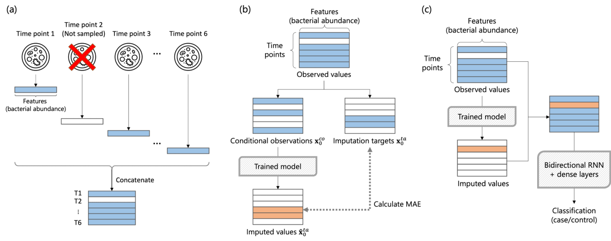

Fig. 1. Outlines of the experiments with an example with time-series length K = 6 and one missing time point. (a) Samples at each time point are processed into abundance profiles and concatenated. (b) Imputation targets are randomly selected and splitted out. In evaluation, mean absolute error (MAE) is calculated for imputed values. (c) Missing time points are imputed with trained model. Input profiles for the predictive task are created by merging the imputed values with observed profiles.

### A. Conditional score-based diffusion model for probabilistic time-series imputation in microbiome profiles

The diffusion model is a family of probabilistic generative models, that generally has two iterative components: the forward process where progressively destruct data by adding noise, and reverse process to denoise them [11]. The overall model structure in this study was based on CSDI, which is a time-series imputation method that uses a scorebased diffusion model conditioned on observed data [13]. This model learns a distribution pθ ( x 0) that approximates a data distribution q ( x 0). Given that x t is a sequence of latent variables for iteration process of t = 1 , ..., T , the reverse process can be described as the following conditional Markov chain:

$$
\begin{aligned}
p_\theta(\mathbf{x}^{ta}_{0:T}\mid\mathbf{x}^{co}_0)
&:=p(\mathbf{x}^{ta}_T)\prod_{t=1}^{T}p_\theta(\mathbf{x}^{ta}_{t-1}\mid\mathbf{x}^{ta}_t,\mathbf{x}^{co}_0),\qquad\text{(1)}\\
\mathbf{x}^{ta}_T&\sim\mathcal{N}(\mathbf{0},\mathbf{I}).\qquad\text{(2)}
\end{aligned}
$$

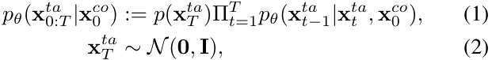

where

$$
p_\theta(\mathbf{x}^{ta}_{t-1}\mid\mathbf{x}^{ta}_t,\mathbf{x}^{co}_0)
:=\mathcal{N}\!\left(\mathbf{x}^{ta}_{t-1};\mu_\theta(\mathbf{x}^{ta}_t,t\mid\mathbf{x}^{co}_0),\sigma_\theta(\mathbf{x}^{ta}_t,t\mid\mathbf{x}^{co}_0)\mathbf{I}\right).\tag{3}
$$

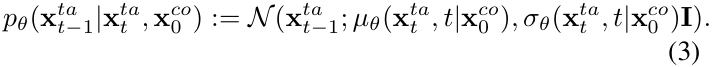

We note that $\mathbf{x}^{ta}_0$ is imputation target and $\mathbf{x}^{co}_0$ is conditional observation. In parameterization of $p_\theta(\mathbf{x}^{ta}_{t-1}\mid\mathbf{x}^{ta}_t,\mathbf{x}^{co}_0)$, parameters defined in the denoising diffusion probabilistic models (DDPM) framework [14] are used in CSDI. The loss function is minimized in the training process as following:

$$
\min_\theta\mathcal{L}(\theta)=\min_\theta
\mathbb{E}_{\mathbf{x}_0\sim q(\mathbf{x}_0),\epsilon\sim\mathcal{N}(\mathbf{0},\mathbf{I}),t}
\left\|\epsilon-\epsilon_\theta(\mathbf{x}^{ta}_t,t\mid\mathbf{x}^{co}_0)\right\|_2^2.\tag{4}
$$

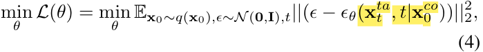

where ϵθ is a trainable denoising function and ϵ is a noise vector. One-layer Transformer encoders are included for each of temporal and feature dimension to take account of dependencies within each dimension.

The microbiome relative abundance data for the i th subject can be represented as X i = {xk,l} , where k ∈{ 1 , ..., K} denotes time points and l ∈{ 1 , ..., L} denotes bacteria species. The imputation targets $\mathbf{x}^{ta}_0$ were randomly selected as illustrated in Fig. 1(b), which were masked and treated as missing data. The number of missing time points by subjects were randomly determined using a binomial distribution. The remaining data were utilized as conditional observations $\mathbf{x}^{co}_0$.

In our experiments, the model was trained with a learning rate of 1e-3 and the training was stopped at 3000th epoch or when the minimum loss was not updated for 1000 consecutive epochs. Imputed values for $\mathbf{x}^{ta}_0$ were sampled from the reverse process 100 times (default), and their medians were obtained.

### B. Dataset

We used the relative abundance profiles of microbiota from the DIABIMMUNE project’s three country cohorts [15], including 16S rRNA and WGS sequencing data. The features were ordered based on their correlation to place correlated features together, as proposed in TaxoNN method [7]. For 16S rRNA data, operational taxonomic units (OTUs) were stratified into phylum categories and Spearman’s correlation coefficient ρ was calculated between all pairs of OTUs within the category. Geometric mean ρOT Uj was calculated for j th OTU:

$$
\rho_{\mathrm{OTU}_j}=\sqrt[p]{\left|\rho_{\mathrm{OTU}_{j1}}\cdot\rho_{\mathrm{OTU}_{j2}}\cdots\rho_{\mathrm{OTU}_{jp}}\right|},\quad 1\le j\le p.\tag{5}
$$

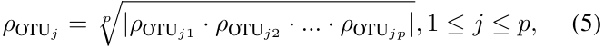

where ρOT Ujp was Spearman’s correlation between OTU j and OTU p . It was sorted in descending order and concatenated between phylum categories. The same approach was applied for WGS data using bacteria species instead of OTUs.

1) 16S rRNA data: We employed the 16S rRNA profile which was used in the DeepMicroGen study [9]. The profile consisted of 115 OTUs at the species level. We included 11 7

<!-- Source page: 3 -->

subjects who had all samples at 4, 7, 10, 13, 16, 19, 22, and 28 months from birth and metadata information of allergies. This resulted in 936 samples in total. The relative abundance values were transformed by the centered log ratio (clr) prior to model training. The value of the minimum abundance divided by two was added to zero values as a pseudo-count before the transformation. Missing ratio r was set between 0.1 and 0.9 in increments of 0.1.

2) WGS data: Relative abundance profiles were produced using MetaPhlAn 4 [16]. Values below 0.01% were replaced to 0 to exclude false-positives, resulting in 1373 features at the species level. Samples were windowed into 6-months intervals from birth: 6, 12, 18, 24, 30 and 36. Subjects with only one sample were excluded from the analysis, while the remaining subjects with incomplete data were included unlike 16S rRNA, due to the lower frequency of data collection. These criteria led to the inclusion of 173 subjects, with missing time points of 50.4%. The values were transformed by clr and missing ratio r was set between 0.2 and 0.8 in increments of 0.1.

### C. Evaluation

To evaluate the imputation performance, we employed a fve-fold i cross-validation, splitting the subjects randomly. As metrics of imputation performance, the mean absolute error (MAE) was calculated for the test set with the following definition:

$$
\mathrm{MAE}=\frac{1}{M}\sum_{i=1}^{M}|y_i-\hat{y}_i|.\tag{6}
$$

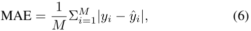

where $y_i$ and $\hat{y}_i$ were observed and predicted values, respectively, and M was the number of features. It was represented for the imputed data using our method, the GAN-based method [9], and a typical linear interpolation method for comparison.

To assess the implications of using imputed data in subsequent analyses, a specific predictive task was conducted for milk, egg, and peanut allergies as illustrated in Fig. 1(c). In evaluation of prediction performance, the area under the curve (AUC) of receiver operational characteristics (ROC) curve and AUC of precision-recall (PR) curve were used as metrics.

## III. EXPERIMENTS

In our experiments, we evaluated the imputation performance on relative abundance profiles derived from 16S rRNA and WGS sequencing data, investigated the characteristics of imputed profiles, and conducted a downstream predictive task.

### A. Diffusion model improved imputation performance in timeseries 16S rRNA data

A comparative analysis was conducted on three methods, namely CSDI, DeepMicroGen and linear interpolation, to assess their performance in the missing imputation task on time-series 16S rRNA profiles. The MAE was calculated to quantify the accuracy of imputation for each fold within 5-fold cross-validation. The resulting MAEs obtained for various levels of missing ratio are summarized in Table I and visually depicted in Fig. 2. These results highlight the superior performance of the CSDI method from the other two

methods, which consistently demonstrated the lowest MAE scores for all missing ratio scenarios. The average MAE demonstrates reduction from 1.922 to 1.571 when comparing DeepMicroGen and CSDI, corresponding to 18% decrease. This distinctive result emphasizes the resilience and practical efficacy of the CSDI approach, given the wide-ranging missing ratio observed across real-world microbiome data. The average elapsed time was approximately 3864 seconds per fold in CSDI while 745 seconds in DeepMicroGen. The denoising procedure in the diffusion model contributes to the overall extended runtime of the algorithm.

We conducted an in-depth examination of the relationship between imputed abundances and their corresponding real abundances, focusing on imputation targets from the 1st fold with a missing ratio setting of 0.5. The visual representation of the imputed and real values is illustrated in Fig. 3(a). Notably, a stronger correlation was observed between the imputed values from the CSDI method and the real abundance values, in contrast to the other two methods. In comparison to GAN-based method, an enhancement in predicting higher abundances, despite the challenge due to the zero-inflated nature, especially contributed to the reduction in MAE. The linear interpolation exhibited a different and constrained predictive performance due to its simplistic reliance solely on temporal information before and after a given time point. Consistently, the CSDI method also demonstrates a favorable trend in terms of Spearman’s correlation coefficient calculated for each sample, as illustrated in Fig. 3(b). CSDI exhibits a median value of approximately 0.78, which is notably higher than the values obtained from the other two methods, which scored 0.41 and -0.15, respectively. These findings underscore the efficacy of CSDI in the task of missing data imputation within microbiome profiles, which are characterized by unique attributes such as high dimensionality, zero-inflation and short time-series.

### B. Investigating characteristics of imputed profiles

We evaluated the characteristics of imputed 16S rRNA profiles with a specific focus on their diversity and count of zeros. The entirety of complete data was used for training purposes, alongside additional data comprising 24 subjects who have true missing time points, which served as a test set. Approximately 51.6% of the additional data were truly missing. The model was trained with a missing ratio setting of 0.5, followed by the imputation of the additional data.

The diversity within each profile is measured through alphadiversity, commonly expressed using the Shannon diversity index. We computed this index for each sample and visually depicted them in Fig. 4(a). Prior to the calculation, we transformed the imputed profiles from clr to relative abundance profiles, employing the same methodology as [9]. The median values for all three methods fell within a narrow range of 2.26 to 2.44. Both CSDI-based imputation and linear interpolation showed similar diversity levels to the real data. DeepMicroGen exhibited a distinct distribution pattern, characterized by diminished variance. This observation indicates a potential

<!-- Source page: 4 -->

TABLE I

COMPARISON OF IMPUTATION METHODS BY MEAN MAES OF 5-FOLD CROSS-VALIDATION ACROSS VARIOUS MISSING RATIOS FOR 16S RRNA DATA. BOLD FONT REPRESENTS THE BEST SCORE.

|Method / missing ratio|0.1|0.2|0.3|0.4|0.5|0.6|0.7|0.8|0.9|
|---|---|---|---|---|---|---|---|---|---|
|CSDI|**1.543**|**1.548**|**1.532**|**1.577**|**1.561**|**1.573**|**1.602**|**1.592**|**1.614**|
|DeepMicroGen|1.795|1.907|1.751|1.743|1.898|1.825|1.927|2.057|2.403|
|Linear|1.737|1.758|1.788|1.840|1.966|2.019|2.078|2.160|2.259|

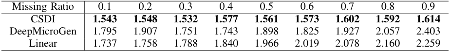

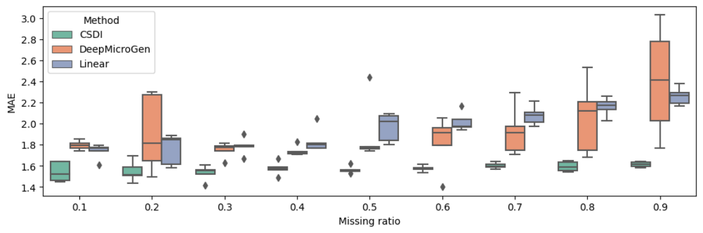

Fig. 2. Comparison of imputation methods by MAEs of 5-fold cross-validation across different missing ratios for 16S rRNA data.

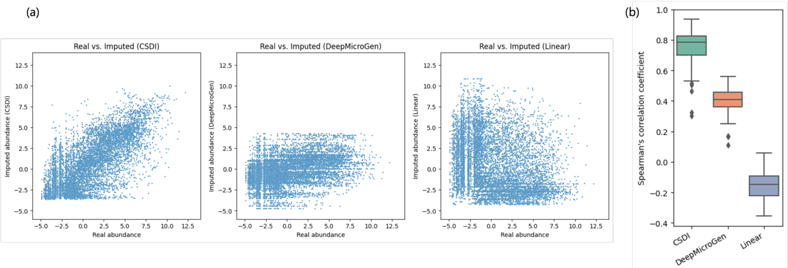

Fig. 3. (a) Distribution of imputed abundance values in 16S rRNA data. Each data point corresponds to an individual value within the imputation targets. The x- and y-axes represent the clr-transformed abundance. (b) Comparison of Spearman’s correlation between imputed and real abundances on 16S rRNA data.

tendency of the method to produce similar abundance profiles across different samples. This finding aligns consistently with the distribution depicted in Fig. 3(a), where the imputed abundances were confined to a relatively small range.

Another important attribute of relative abundance profiles is the zero-inflation characteristic. The proportion of zero abundances included in the profiles is graphically exhibited in Fig. 4(b). It is noteworthy that the real profiles encompass approximately 50% of zero abundance values. While CSDI demonstrated larger proportion compared to GAN-based imputation, it remained smaller than that observed in the real profiles. This insight underscores the complexity associated with prediction of zeros for newly introduced dataset, even though the models are capable of predicting the order of magnitude, as demonstrated in Fig. 3(b).

### C. Prediction was improved with imputed 16S rRNA profiles

To explore the impact on downstream tasks, we carried out a predictive analysis with imputed 16S rRNA profiles using the bidirectional RNN model, following the procedure outlined in Fig. 1(c). Missing time points were randomly created for 20% of the complete data of 117 subjects, and the additional dataset of 24 subjects with true missing time points were combined to be used as the input for the predictive task. In addition to the imputed data by CSDI, DeepMicroGen and linear interpolation, the original non-imputed dataset was used for the comparison. Masking approach was employed, enabling to use the data with heterogeneous lengths in the RNN model. ROCAUC and PR-AUC were obtained by five-time 5-fold crossvalidations considering result variability, and summarized in

<!-- Source page: 5 -->

TABLE II

COMPARISON OF ROC-AUC AND PR-AUC BY FIVE-TIME 5-FOLD CROSS-VALIDATION WITH MEAN AND STANDARD DEVIATION ACROSS DIFFERENT IMPUTATION METHODS: CSDI, DEEPMICROGEN, LINEAR AND MASKING (NO IMPUTATION). BOLD FONT REPRESENTS THE BEST SCORE.

|Allergy|ROC-AUC: CSDI|ROC-AUC: DeepMicroGen|ROC-AUC: Linear|ROC-AUC: Masking (no imputation)|PR-AUC: CSDI|PR-AUC: DeepMicroGen|PR-AUC: Linear|PR-AUC: Masking (no imputation)|
|---|---|---|---|---|---|---|---|---|
|Milk|**0.542 (0.094)**|0.540 (0.119)|0.451 (0.100)|0.491 (0.096)|**0.391 (0.086)**|0.380 (0.121)|0.342 (0.083)|0.355 (0.089)|
|Egg|0.505 (0.128)|0.552 (0.145)|0.523 (0.103)|**0.587 (0.103)**|0.333 (0.107)|0.331 (0.111)|0.312 (0.082)|**0.375 (0.087)**|
|Peanut|**0.619 (0.210)**|0.514 (0.243)|0.470 (0.257)|0.450 (0.270)|**0.205 (0.177)**|0.169 (0.130)|0.142 (0.128)|0.138 (0.120)|

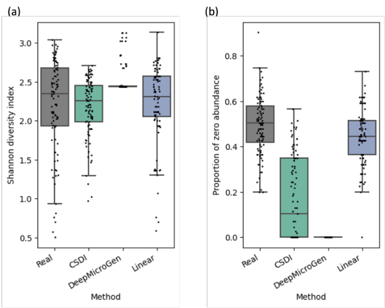

Fig. 4. Comparison of relative abundance profiles. Each data point represents a individual abundance profile. (a) The distribution of alpha-diversity. (b) The distribution of proportion of zero-abundance.

Table II. The input data imputed using CSDI outperformed the results obtained from other methods for milk and peanut allergies. These results highlight that the imputation process successfully enhanced the prediction performance for these outcomes through the use of the RNN-based model. Conversely, the beneficial impact of imputation was not observed for egg allergy. One possible explanation could be the limited data size, consisting of only 141 subjects, which might be insufficient to adequately train the model and the imputation might have introduced noise, contrary to expectations. Further investigation is needed to gain the underlying causes and explore alternative strategies for improvement.

### D. Application of the imputation method on WGS data

Imputation was performed on the metagenomic profiles derived from the WGS data. The MAEs are summarized in Table III, exhibiting a slightly different pattern from 16S rRNA data represented in Table I. CSDI demonstrates similar MAE scores with DeepMicroGen. The inherent attributes of WGS data, characterized by its large dimentionality over 10 times that of 16S rRNA data (1373 vs. 115), along with zero-inflation, contribute to the complexity of prediction. The availability constraints of complete data for WGS should also be recognized, wherein approximately 50.4% of the time points were missing. Notably, we observed a favorable result for CSDI in Fig. 5. It demonstrated a subtle yet positive cor-

relation comparing to the other methods. One possible reason for the increased MAE observed with CSDI is its tendency to impute relatively higher values for certain bacteria species, even when their actual abundances were zero. The bacterium with the largest error was P. vulgatus , which is one of the most numerous organisms within the family of Bacteroidaceae in the colon [17]. The abundance of P. vulgatus undergoes dynamic fluctuations overtime, which could contribute to the complexity of prediction. This finding should be approached in the future exploration.

## IV. DISCUSSION

Our study has demonstrated that diffusion model-based method exhibits remarkable performance in the task of missing data imputation within time-series microbiome data. This approach yielded notably smaller MAEs in comparison to alternative methods, particularly in the context of 16S rRNA data. The imputed values showed a robust correlation with the true values, a relationship supported by the distribution of Spearman’s correlation coefficient between them. Furthermore, in the predictive task focusing on allergy outcomes, the data imputed through the diffusion model showed the highest scores on milk and peanut allergies. Our findings indicate that the diffusion model, founded on the CSDI method [13], delivers exceptional performance in this imputation task.

It is essential to acknowledge the limitations of our study. First, prediction of zero abundances remained a challenging task. Given that researcher interest commonly centers on relative abundance profiles for interpretation, the capacity to produce realistic abundance profile is crucial. Second, the diffusion model-based method necessitates a relatively prolonged execution time in comparison to other method. Third, this study was conducted using data derived from a single study, and there is a need for further evaluation using additional datasets with varying characteristics including different time spans. These limitations should be carefully taken into account when interpreting the implications of our findings.

Our study offers the effective utilization of time-series microbiome data containing missing values. For future investigation, employing data imputation methodologies capable of incorporating background factors has the potential to yield profound benefits. Additionally, it is worth exploring their applicability in predicting future time points. Such advancements potentially contribute not only in unveiling underlying mechanism but also in representing a step towards developing personalized prevention and treatment strategies.

<!-- Source page: 6 -->

TABLE III

COMPARISON OF IMPUTATION METHODS BY MEAN MAES OF 5-FOLD CROSS-VALIDATION FOR WGS DATA. BOLD FONT REPRESENTS THE BEST SCORE.

|Method / missing ratio|0.2|0.3|0.4|0.5|0.6|0.7|0.8|
|---|---|---|---|---|---|---|---|
|CSDI|**0.203**|0.218|**0.201**|**0.203**|0.212|**0.205**|**0.213**|
|DeepMicroGen|0.208|**0.206**|0.218|0.217|**0.202**|0.268|0.229|
|Linear|0.263|0.268|0.280|0.280|0.289|0.293|0.292|

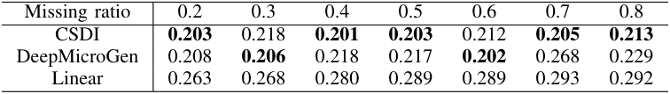

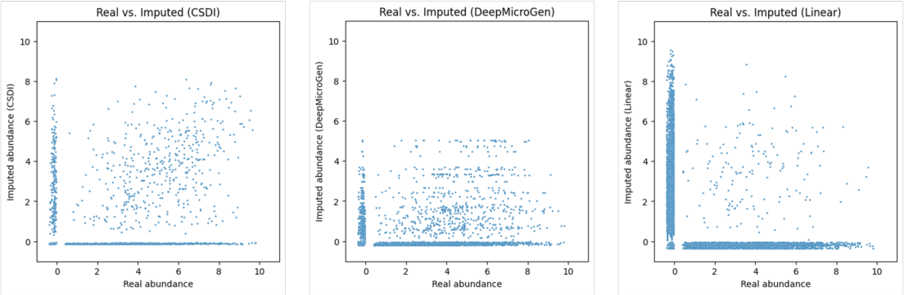

Fig. 5. Distribution of imputed abundance values in WGS data. Each data point corresponds to an individual value within the imputation targets. The x- and y-axes represent the clr-transformed abundance.

## V. CONCLUSION

In this study, we proposed a novel method for imputing missing data in time-series microbiome abundance profiles using a diffusion model. The proposed method demonstrated improvements, notably in the reduction of MAE of imputed values when compared to previous methods, especially in 16S rRNA data. In addition, the performance in a downstream predictive task was enhanced with imputed data by our proposed method, achieving the highest scores for specific outcomes.

## ACKNOWLEDGEMENTS

This research was supported by Grant-in-Aid for Scientific Research (JSPS KAKENHI Grant Number JP21K12104 to Y.Z.; Grant Number 21H03538 to S.I.) from Japan Society for the Promotion of Science and the Uehara Memorial Foundation (to S.I.). The computing resources were provided by Human Genome Center, the Institute of Medical Science, the University of Tokyo.

## CONFLICTS OF INTEREST

Misato Seki is an employee of GlaxoSmithKline. However, GlaxoSmithKline was not involved in this study.

## REFERENCES

- [1] C. Tseng and C. Wu, ”The gut microbiome in obesity,” Journal of the Formosan Medical Association, vol. 118, pp. S3-S9, 2019.

- [2] S. Sharma and P. Tripathi, ”Gut microbiome and type 2 diabetes: where we are and where to go?,” The Journal of Nutritional Biochemistry, vol. 63, pp. 101-108, 2019, Elsevier.

- [3] D. G. Peroni, G. Nuzzi, I. Trambusti, M. E. Di Cicco, and P. Comberiati, ”Microbiome Composition and Its Impact on the Development of Allergic Diseases,” Frontiers in Immunology, vol. 11, p. 700, 2020, Frontiers Media S.A.

   - [5] A. R. Coenen, S. K. Hu, E. Luo, D. Muratore, and J. S. Weitz, ”A primer for microbiome time-series analysis,” Frontiers in Genetics, vol. 11, p. 310, 2020, Frontiers Media SA.

   - [6] D. Sharma and W. Xu, ”phyLoSTM: a novel deep learning model on disease prediction from longitudinal microbiome data,” Bioinformatics, vol. 37, no. 21, pp. 3707-3714, 2021, Oxford University Press.

   - [7] D. Sharma, A. D. Paterson, and W. Xu, ”TaxoNN: ensemble of neural networks on stratified microbiome data for disease prediction,” Bioinformatics, vol. 36, no. 17, pp. 4544-4550, 2020, Oxford University Press.

   - [8] S. Kodikara, S. Ellul, and K. A. Lˆe Cao, ”Statistical challenges in longitudinal microbiome data analysis,” Briefings in Bioinformatics, vol. 23, no. 4, pp. bbac273, 2022.

   - [9] J. M. Choi, M. Ji, L. T. Watson, and L. Zhang, ”DeepMicroGen: a generative adversarial network-based method for longitudinal microbiome data imputation,” Bioinformatics, vol. 39, no. 5, p. btad286, 2023.

   - [10] Z. Pan, W. Yu, X. Yi, A. Khan, F. Yuan, and Y. Zheng, ”Recent progress on generative adversarial networks (GANs): A survey,” IEEE Access, vol. 7, pp. 36322-36333, 2019.

   - [11] L. Yang, et al. , ”Diffusion models: A comprehensive survey of methods and applications,” arXiv preprint arXiv:2209.00796, 2022.

   - [12] L. Lin, Z. Li, R. Li, X. Li, and J. Gao, ”Diffusion Models for Time Series Applications: A Survey,” arXiv preprint arXiv:2305.00624, May 2023.

   - [13] Y. Tashiro, J. Song, Y. Song, and S. Ermon, ”CSDI: Conditional scorebased diffusion models for probabilistic time series imputation,” in Advances in Neural Information Processing Systems, vol. 34, pp. 2480424816, 2021.

   - [14] J. Ho, A. Jain, and P. Abbeel, ”Denoising diffusion probabilistic models,” in Advances in Neural Information Processing Systems, vol. 33, pp. 6840-6851, 2020.

   - [15] T. Vatanen, et al. , ”Variation in microbiome LPS immunogenicity contributes to autoimmunity in humans,” Cell, vol. 165, no. 4, pp. 842853, 2016, Elsevier.

   - [16] A. Blanco-M´ıguez, et al. , ”Extending and improving metagenomic taxonomic profiling with uncharacterized species using MetaPhlAn 4,” Nature Biotechnology, pp. 1-12, 2023.

   - [17] R. L¨uck and U. Deppenmeier, ”Genetic tools for the redirection of the central carbon flow towards the production of lactate in the human gut bacterium Phocaeicola (Bacteroides) vulgatus,” Applied Microbiology and Biotechnology, vol. 106, no. 3, pp. 1211-1225, 2022.

- [4] M. Carabotti, A. Scirocco, M. A. Maselli, and C. Severi, ”The gutbrain axis: interactions between enteric microbiota, central and enteric nervous systems,” Annals of gastroenterology: quarterly publication of the Hellenic Society of Gastroenterology, vol. 28, no. 2, pp. 203, 2015.

## Conversion notes

This Markdown preserves the article text, section structure, references and available figure captions. Displayed equations were manually transcribed from the source renderings; original equation crops and complete page snapshots remain available for visual verification. Repeated running headers, page numbers and publisher icons were omitted from the extracted reading text. PDF highlights were removed from the text formatting but remain visible in the snapshots. Superscripts in remaining inline notation are represented explicitly. This conversion does not add the separately published supplementary files.

## Source page snapshots

The page numbers below refer to the original PDF, starting at 1. Keep the `_assets` folder with this Markdown file.

- [PDF page 01](_assets/paper2023/page-01.png)
- [PDF page 02](_assets/paper2023/page-02.png)
- [PDF page 03](_assets/paper2023/page-03.png)
- [PDF page 04](_assets/paper2023/page-04.png)
- [PDF page 05](_assets/paper2023/page-05.png)
- [PDF page 06](_assets/paper2023/page-06.png)
