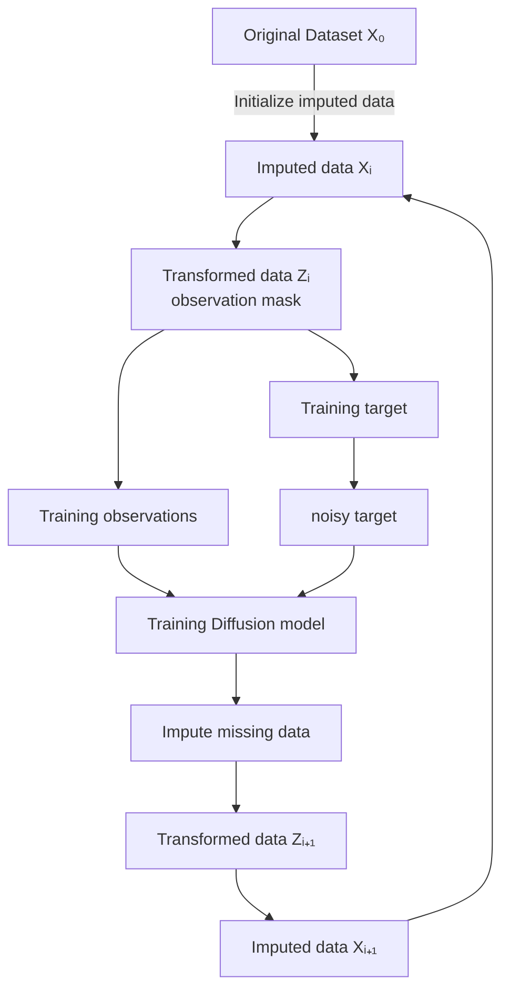
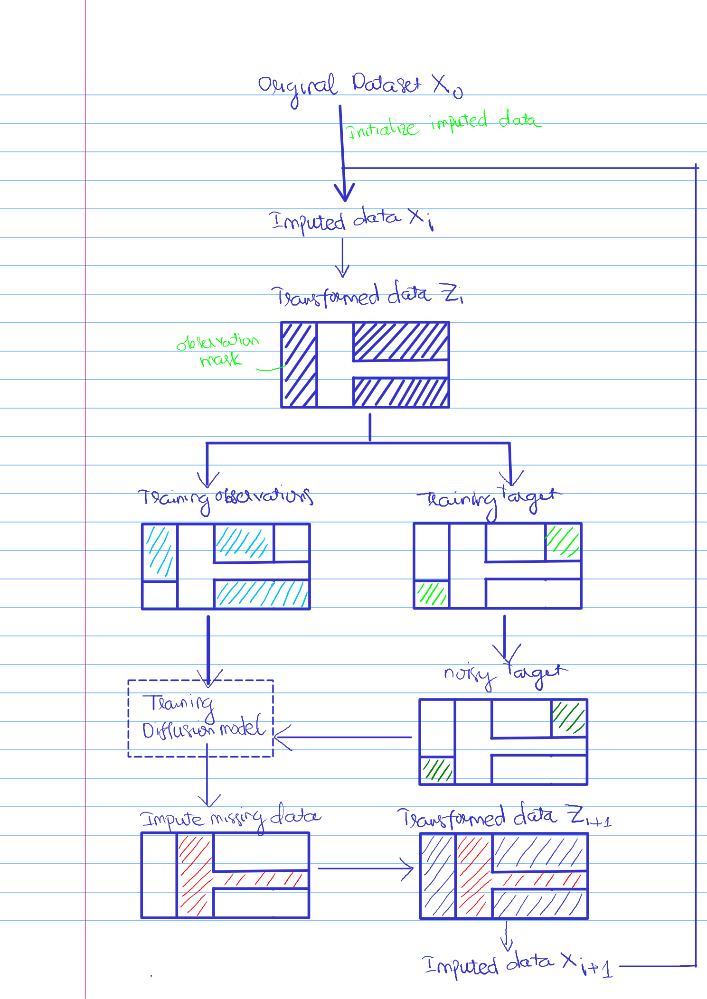

# Missing imputation diffusion: handwritten workflow

Tài liệu gốc là một sơ đồ viết tay, không có lớp văn bản. Các nhãn tiếng Anh dưới đây được chép từ hình; phần diễn giải tiếng Việt mô tả các mũi tên và vùng màu trong sơ đồ. Các diễn giải chưa được ghi rõ trên hình được đánh dấu riêng.

## Nhãn gốc và ký hiệu

| Nhãn trong sơ đồ | Ký hiệu / ý nghĩa thể hiện trên hình |
|---|---|
| Original Dataset $X_0$ | Dữ liệu ban đầu |
| Initialize imputed data | Khởi tạo dữ liệu điền khuyết |
| Imputed data $X_i$ | Dữ liệu đã điền ở vòng $i$ |
| Transformed data $Z_i$ | Biểu diễn sau phép biến đổi |
| observation mask | Mặt nạ chỉ các phần được quan sát |
| Training observations | Phần quan sát dùng làm đầu vào huấn luyện |
| Training target | Phần mục tiêu huấn luyện |
| noisy target | Mục tiêu sau khi thêm nhiễu |
| Training Diffusion model | Khối huấn luyện mô hình diffusion |
| Impute missing data | Điền các phần còn thiếu |
| Transformed data $Z_{i+1}$ | Biểu diễn sau khi cập nhật các phần thiếu |
| Imputed data $X_{i+1}$ | Dữ liệu điền khuyết của vòng tiếp theo |

## Luồng xử lý thể hiện trên hình

1. Bắt đầu từ **Original Dataset $X_0$**.
2. **Initialize imputed data** tạo **Imputed data $X_i$**.
3. Chuyển $X_i$ thành **Transformed data $Z_i$**.
4. Tại $Z_i$, sơ đồ đánh dấu **observation mask** và tách hai nhánh: **Training observations** và **Training target**.
5. **Training target** đi xuống **noisy target**.
6. **Training observations** và **noisy target** cùng đi vào **Training Diffusion model**.
7. Khối mô hình đi xuống **Impute missing data**, được tô đỏ tại những vùng thiếu.
8. Các vùng được điền được ghép với phần dữ liệu còn lại để tạo **Transformed data $Z_{i+1}$**.
9. $Z_{i+1}$ đi xuống **Imputed data $X_{i+1}$**.
10. Một mũi tên dài bên phải dẫn từ $X_{i+1}$ quay trở lại đường vào **Imputed data $X_i$**, thể hiện việc lặp lại quy trình.

## Sơ đồ bằng Mermaid

## Các vùng màu trong sơ đồ

| Vùng / màu | Quan sát trực tiếp từ hình |
|---|---|
| Gạch chéo xanh đậm trong $Z_i$ | Các vùng được nhãn “observation mask” chỉ tới |
| Gạch chéo xanh nhạt trong Training observations | Một phần của các vùng quan sát |
| Gạch chéo xanh lá trong Training target | Các vùng khác nằm trong những vùng quan sát ban đầu |
| Gạch chéo xanh lá trong noisy target | Các vị trí mục tiêu tương ứng sau bước tạo nhiễu |
| Gạch chéo đỏ trong Impute missing data | Vùng cần được điền; hình thể hiện một dải dọc nối với một dải ngang |
| Gạch chéo xanh đậm và đỏ trong $Z_{i+1}$ | Vùng quan sát ban đầu và vùng được điền cùng xuất hiện trong dữ liệu cập nhật |

**Diễn giải từ bố cục:** nhánh mục tiêu huấn luyện được chọn từ phần có quan sát, còn vùng đỏ là phần thiếu cần điền. Sơ đồ gợi ý cách chia dữ liệu quan sát để huấn luyện rồi cập nhật dữ liệu điền khuyết qua nhiều vòng. Đây là diễn giải của hình, không phải một công thức hay thuật toán được tác giả viết kèm.

## Phạm vi thông tin của bản phác thảo

Sơ đồ không nêu tên phép biến đổi $X_i\rightarrow Z_i$, phép chuyển ngược $Z_{i+1}\rightarrow X_{i+1}$, phương pháp khởi tạo, định nghĩa số học của mặt nạ, lịch nhiễu, hàm mất mát, kiến trúc mạng, hay điều kiện dừng. Vì vậy bản chuyển đổi giữ các bước ở mức nhãn và quan hệ trong hình. Chỉ số $i$ đánh dấu vòng cập nhật dữ liệu; hình không định nghĩa quan hệ giữa $i$ và chỉ số bước diffusion.

## Trang gốc để đối chiếu

Ảnh trang gốc giữ nguyên các nhãn, màu, vùng tô và đường hồi tiếp. Giữ thư mục `_assets` cùng file Markdown này.

