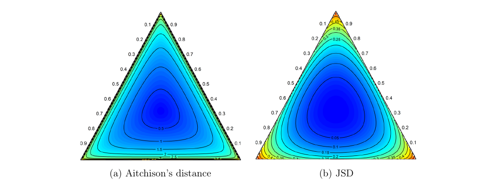
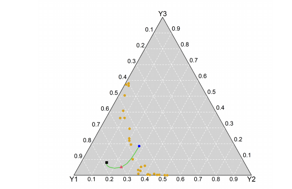
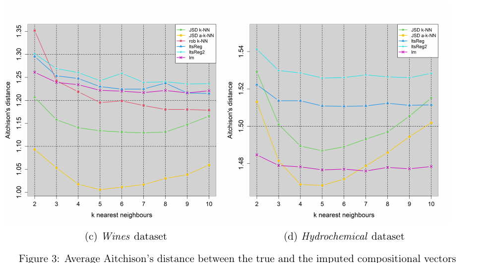
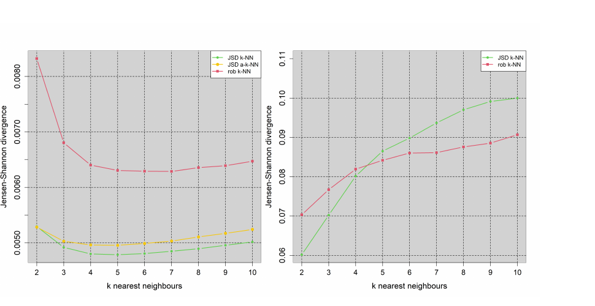

# A Jensen-Shannon divergence based k-NN algorithm for missing value imputation in compositional data

**Authors:** Michail Tsagris, Connie Stewart, and Abdulaziz Alenazi  
**Date:** May 29, 2026  
**Source:** arXiv:2605.29702v1 · DOI: 10.48550/arXiv.2605.29702

## Abstract

A novel nonparametric method to impute missing values in compositional data is developed. The

method is based on the k–NN algorithm, utilizes the Jensen-Shannon divergence and employs

the Fréchet mean to allow for more flexibility in the estimation process. As an extra feature,

the hyper-parameters can be self-adaptive according to the pattern of missing values. Unlike

restrictive parametric models, the proposed method makes no assumption about the structure

of the data and, most importantly, it is applicable even when compositional data contain zero

values. Through simulation studies using real data, it is shown that the proposed algorithm

outperforms competing algorithms at various settings, not only in terms of accuracy but also in

terms of computational efficiency.
**Keywords:** compositional data, missing values, k–NN algorithm, Fréchet mean

## 1 Introduction

Missing values in real-life data are common and can be divided into three categories (Little and

Rubin, 2019). Values in a data set are missing completely at random (MCAR) if the events

that lead to any particular data-item being missing are independent both of observable variables

and of unobservable parameters of interest, and occur entirely at random. Missing at random

(MAR) occurs when the missingness is not random, but instead can be fully accounted for by

variables where there is complete information. Lastly, missing not at random (MNAR) (also

known as non-ignorable non-response) involves data that are neither MCAR nor MAR (i.e. the

value of the variable that is missing is related to the reason it is missing). This paper addresses

the imputation of missing values under the MAR case scenario, with an extension that can be
used when there are patterns in the missing values.

Numerous methods have been developed for imputing missing values in multivariate data,
but significantly fewer approaches have been tailored to address the unique challenges posed by
compositional data. Compositional data are non-negative multivariate vectors that convey only
relative information, often normalized to sum to 1, and the corresponding treatment of missing
values must take into account their restrictive sample space. Specifically, the sample space is the
standard simplex given below

$$
S^{D-1} = \left\{(u_1,\ldots,u_D)^\top \mid u_i \ge 0,\; \sum_{i=1}^{D}u_i=1\right\}, \tag{1}
$$

where D denotes the number of variables, usually referred to as components.
Compositional data are prevalent across numerous application domains (see Tsagris and Stewart (2020) for a variety of examples), and there is a wide range of literature published on methodology for properly analyzing compositional data. The traditional recommended approach for
handling compositional data involves transforming the data to Euclidean space using a log-ratio
transformation, followed by the application of standard multivariate techniques. Consequently,
zeros in compositional data pose challenges for this strategy, and there has been substantial
interest in alternative techniques for dealing with compositional data containing zeros.

The literature differentiates between the types of zeros. Structural or essential zeros refer to
zeros representing a true absence in the components, while rounded zeros refer to components
that have been either rounded to zero or fall below detection limit. For instance, in ecology, the
diet composition of predators may be estimated using stomach content analysis. A structural
zero can occur if a particular species is not found in the contents. Zeros in fatty acid signatures,
which are also used to estimate diet, can be due to limitations of the measuring device and
are typically treated as rounded zeros (Stewart et al. (2014)). Depending on the type of zeros
present, different methodologies are recommended, but dealing with structural zeros is generally
considered to be more challenging. Approaches for handling this type of zero have been proposed
in a variety of contexts (Stewart and Field (2011), Tsagris and Stewart (2018), Scealy and Welsh
(2011), Bear and Billheimer (2016)). We note that as our proposed procedure does not use log-ratio transformations, it is applicable when either type of zero, including structural, is present
in the data.

Aitchison (2003) proposed using zero value substitution or imputation strategies for replacing
rounded zeros occurring in compositional data while Martín-Fernández et al. (2003) proposed
nonparametric imputation to tackle the problem of either rounded zeros or missing values. The
literature documents more broadly strategies for the replacement of rounded zeros, compared to
methods for imputing general missing values. However, in some cases, the proposed algorithms
for imputing rounded zeros can be adjusted to accommodate missing values (Palarea-Albaladejo
and Martín-Fernández, 2008).
In contrast, Hron et al. (2010) suggested two algorithms for imputing missing values for compositional data which encompass both classical and robust versions. The first algorithm imputes
missing values using the k–NN procedure and the Aitchison’s distance (4), a commonly accepted
distance measure in compositional data analysis. With this algorithm, a missing value in a com-
positional vector is imputed using the observed component values of the vector and computing
the Aitchison’s distance from all other compositional vectors that have no missing values (using
the same components). Based on these distances the k nearest neighbouring vectors are detected.
Each component value of those vectors is weighted based on their values and the imputation of
the missing component values takes place using the median of those weighted values. As this
algorithm does not fully utilize the relationship between the compositional components, Hron
et al. (2010) also proposed using regression models (linear regression or least trimmed regression)
for the imputation with the models being applied in an iterative fashion until some convergence
criteria based on the covariance matrix of the log-ratio transformed data is met. Both of these
algorithms are available in the R package robCompositions (Templ et al., 2011).
Alternative strategies include the multiple imputation by chained equations (MICE) framework that offers a flexible framework for handling missing data in complex datasets (van Buuren
et al., 2006, van Buuren and Groothuis-Oudshoorn, 2011). Non-parametric imputation using
random forest (Doove et al., 2014, Shah et al., 2014, XiaoQin and Yuying, 2017) is another option. A limitation of these methods is the requirement to apply log-ratio transformations prior
to analysis, which precludes the presence of zeros in the data. While zero value imputations
could be applied, the modifications can induce bias (Tsagris, 2015), especially when the zeros
are structural and not rounded.
This paper proposes a new k–NN based algorithm for missing value imputation in compositional data that uses the Jensen-Shannon divergence (JSD) and the flexible sample Fréchet mean
(6) defined by Tsagris et al. (2011). The Fréchet mean extends the simple arithmetic mean by
introducing a power hyper-parameter, α. The proposed algorithm offers several advantages over
the competing methods in Hron et al. (2010). In particular, our proposed algorithm allows for
zeros in the non-missing parts and is also more computationally efficient in terms of tuning the
value of k and imputing the missing values. An extension to the algorithm is also developed
that allows the hyper-parameters (α and k) to be self-adaptive, depending on the pattern of
missing values. Simulation studies based on several examples of real-life data demonstrate that
the proposed algorithms have wide-ranging applicability and are consistently more accurate than
the methods in Hron et al. (2010).

Disaggregation of multivariate data can yield missing information. For example, Xavier
et al. (2018) dis-aggregated agricultural data concerning land-use at the detailed pixel level.
Concerning the compositional data field specifically, consider the agriculture application where,
in some geographical areas, information is provided on the production of numerous crops, whereas
in other areas production of groups of crops is reported, and the task of interest is to dis-aggregate
the grouped crop production to match other areas. The need to dis-aggregrate data (and estimate
missing values) is encountered in other contexts as well. For instance, while many countries report
the total number of deaths, some may not provide the number of deaths attributed to specific
causes (Lopez et al., 2020).

The new missing value imputation algorithm is introduced in Section 2. Extensive simulation
studies are displayed in Section 3 illustrating the performance of the proposed algorithms using
real-life data with varying features. Concluding remarks are outlined in Section 4.

## 2 Missing value imputation in compositional data
The proposed algorithm and extensions impute missing values arising in compositional data using
the k–NN procedure which, in turn, requires measuring distance between compositional vectors.
Measuring distance in the simplex necessitates special considerations and Euclidean distance is
generally regarded as unsuitable in this context due to it not satisfying key properties described
below. In the following, we first formally define the types of missing values and then contrast
Aitchison’s distance measure, previously used for missing value imputation in compositional data
Hron et al. (2010), and the JSD which underpins our proposed method detailed in Subsection
2.3.

### 2.1 Formal missing values conditions

**Definition 2.1.** Let \(\mathbf R=(R_1,\ldots,R_D)\) be the missingness-indicator vector, where \(R_j=1\) if component j is observed and \(R_j=0\) if it is missing. The data are MCAR if:

$$
P(\mathbf R=\mathbf r\mid\mathbf X=\mathbf x)=P(\mathbf R=\mathbf r). \tag{2}
$$

for all \(x\in S^{D-1}\) and all missingness patterns r ∈ {0,1}D.

**Definition 2.2.** The missing data are MAR if:

$$
P(\mathbf R=\mathbf r\mid\mathbf X=\mathbf x)=P(\mathbf R=\mathbf r\mid\mathbf X^o=\mathbf x^o). \tag{3}
$$

where \(X^o\) denotes the observed components. That is, the probability of missingness depends
only on the observed values, not on the missing values.

MNAR is the most complex type of missing data as the probability of missingness in this case
is related to the unobserved data. In this work, we assume the MAR scenario. While MAR cannot
be directly tested from observed data alone (Molenberghs and Kenward, 2007), some diagnostic
approaches can be used to assess plausibility. For example, the distributions of the observed
components, \(X^o\), between complete and incomplete observations may be compared with large
differences suggesting potential MNAR. However, with compositional data, we could examine
whether missingness is related to component magnitudes (for example, small values being more
likely missing suggesting censoring MNAR) or check specific component combinations which may
indicate informative missingness. External validation could also be performed via a subset with
complete data to assess imputation accuracy.

### 2.2 Distance Measures for Compositional Data

#### 2.2.1 Aitchison’s distance
Aitchison (2003) defined distance between two compositional vectors x and y as

$$
d(\mathbf x,\mathbf y)=\left[\sum_{j=1}^{D}\left(\log\frac{x_j}{g(\mathbf x)}-\log\frac{y_j}{g(\mathbf y)}\right)^2\right]^{1/2}, \tag{4}
$$

where \(g(\mathbf x)=\left(\prod_{j=1}^{D}x_j\right)^{1/D}\) is the geometric mean of the components of x and \(\log(.)\) refers to the natural logarithm (logarithm with base e). Alternatively, the Aitchison’s distance between
two compositions is the ordinary Euclidean distance between the compositions transformed by
the centered logratio (clr) transformation (Aitchison (2003)). Aitchison’s distance is the key
component of Hron et al.’s (2010) k–NN algorithm.

Aitchison (1992) argued that a distance on the simplex should satisfy certain properties,
namely scale invariance, sub-compositional dominance and perturbation invariance. Scale invariance ensures that the distance between x and y is the same as the distance between kx
and Ky, for positive constants k and K. Concerning subcompositional dominance, consider
two compositional vectors and select sub-vectors, each consisting of the same components. Subcompositional dominance means that the distance between the sub-vectors is always less than
or equal to the distance between the original compositional vectors. Finally, the perturbation
requirement is that the distance between compositional vectors x and y should be the same as
distance between x ⊕ p and y ⊕ p, where the operator \(\oplus_0\) means element-wise multiplication and then division by the sum, so that the resulting vectors belong to \(S^d\), and p is any vector
(not necessarily compositional) with positive components.

In contrast, Scealy and Welsh (2014) argued that these properties were derived from the
attributes of the log-ratio methods themselves, and then used to justify those same methods as
uniquely valid, therefore reversing proper scientific reasoning. Despite design intent, log-ratio
methods violate subcompositional coherence when, for example, analyzing sub-partitioned data
or when applying robust methods (since outliers may be masked in the full composition but not
in some subcomposition). Specifically for the subcompositional coherence property, we quote
Scealy and Welsh (2014) "Moreover, it is applied selectively because it is not actually satisfied
by the log-ratio methods it is intended to justify." Further, when problems do not allow for
log-ratio methods (due to the presence of zeros, for example), these data have been defined
as "non-compositional" rather than acknowledging those cases as limitations. Regardless, from
a practical point of view, when compositional vectors are normalized prior to analysis, as is
assumed here, the scale invariant property is irrelevant. With respect to distance measures,
when compositional data contain zeros, reasonable trade-offs may be necessary (Stewart, 2017),
as Aitchison’s distance cannot accommodate zeros directly.

#### 2.2.2 Jensen-Shannon divergence
Our proposed algorithm employs an alternate approach for measuring distance between two
compositional vectors \(x,y\in S^{D-1}\), namely the Jensen-Shannon divergence (JSD) (multiplied
by a factor of 2)

$$
\operatorname{JSD}(\mathbf x,\mathbf y)=\sum_{j=1}^{D}\left[x_j\log\left(\frac{2x_j}{x_j+y_j}\right)+y_j\log\left(\frac{2y_j}{x_j+y_j}\right)\right]. \tag{5}
$$

Note that JSD is bounded from above by \(2\log 2\). Endres and Schindelin (2003) and Oesterreicher and Vajda (2003) independently proved that the square root of (5), \(\sqrt{\operatorname{JSD}}\), satisfies the triangular identity and thus is a metric. Moreover, Endres and Schindelin (2003) showed that the limiting behavior of JSD as \(\mathbf x\to\mathbf y\) is approximately equal to the \(\chi^2\) distance:

$$
\operatorname{JSD}(\mathbf x,\mathbf y)\approx\sum_{j=1}^{D}\frac{1}{4y_j}(x_j-y_j)^2.
$$

> **1.** For a series of inequalities see Lin (1991).

A useful practical property of the JSD is that, unlike the Aitchison distance or the Kullback-
Leibler divergence (KLD), an alternative measure of difference in compositional data, zero values
are treated naturally since 0log0 = 0, thus allowing the application of the proposed imputation
algorithm to compositional data with zeros. JSD is a member of the \(\phi\)-divergence family and can be seen as a symmetrized version of the KLD:

$$
\operatorname{JSD}(\mathbf x,\mathbf y)=\operatorname{KL}(\mathbf x,\mathbf M)+\operatorname{KL}(\mathbf y,\mathbf M)=\sum_{j=1}^{D}\left[x_j\log\left(\frac{x_j}{M_j}\right)+y_j\log\left(\frac{y_j}{M_j}\right)\right],
\qquad \mathbf M=\frac{\mathbf x+\mathbf y}{2}.
$$

#### 2.2.3 Contour plots of Aitchison’s distance and JSD
Contour plots visualizing the Aitchison’s distance (4) and the JSD (5) illustrate the differences
between these two distances. The produced contour plots show both simplicial distances for
many points on the S2 from its centre. Evidently Aitchison’s distance produces contours (Figure
1(a)) that better fit the triangle (ternary plot) compared to the contours produced by JSD
(Figure 1(b)) that are more circular. However, while the Aitchison’s distance contours may be
perceived as more advantageous compared to the JSD’s contours (their shape seems to fit better
in the triangle as seen in Figure 1(a)), JSD’s more circular contours do not appear to affect the
proposed algorithm’s performance in practice as we show in Section 3.

*Figure 1: Contour plots of Aitchison's distance and the Jensen-Shannon divergence.*

### 2.3 The JSD-based k-NN algorithm

#### 2.3.1 Basic algorithm

The k-NN algorithm is a nonparametric prediction technique based on distances between points. It makes no parametric assumptions about the data. The simplex structure makes it important to use an appropriate distance and to use the information from the complete compositions. Since structural zeros may be present, the paper uses JSD rather than Aitchison's distance.

The proposed JSD k-NN searches for the k nearest neighbours among complete observations, similar to approach (1)(a) in Hron et al. (2010). Here, M denotes rows with missing values and O denotes complete rows. Superscript o denotes observed components, m denotes missing components, and c denotes normalized components.

**Step 1.** Select k, the number of nearest neighbours. Section 2.4.1 describes cross-validation for selecting k.

**Step 2.** Separate the incomplete rows X_M from the complete rows X_O. For the running example:

$$
X=\begin{bmatrix}
0.2 & \mathrm{NA} & 0.3 & 0.1 & \mathrm{NA} \\
0.1 & 0.2 & 0.4 & 0.1 & 0.2 \\
0.2 & 0.4 & 0.2 & 0.1 & 0.1 \\
0.1 & 0.3 & 0.3 & 0.2 & 0.1
\end{bmatrix},\qquad
X_M=\begin{bmatrix}0.2 & \mathrm{NA} & 0.3 & 0.1 & \mathrm{NA}\end{bmatrix},\qquad
X_O=\begin{bmatrix}
0.1 & 0.2 & 0.4 & 0.1 & 0.2 \\
0.2 & 0.4 & 0.2 & 0.1 & 0.1 \\
0.1 & 0.3 & 0.3 & 0.2 & 0.1
\end{bmatrix}.
$$

**Step 3a.** For an incomplete row i, let X^o_{M,i} be its observed components. Restrict each complete row to those same observed positions to obtain X^o_O; let X^m_O denote the remaining components. In the example, the observed positions are 1, 3, and 4:

$$
X^o_{M,1}=[0.2,0.3,0.1],\qquad
X^o_O=\begin{bmatrix}0.1&0.4&0.1\\0.2&0.2&0.1\\0.1&0.3&0.2\end{bmatrix},\qquad
X^m_O=\begin{bmatrix}0.2&0.2\\0.4&0.1\\0.3&0.1\end{bmatrix}.
$$

**Step 3b.** Normalize the observed components of the incomplete row and of each complete row to sum to 1. Let

$$
T_i=1-\sum_{j=1}^{D}X^o_{M,i,j},
$$

the remaining mass assigned to the missing components. In the example, the query's observed subcomposition becomes [0.33, 0.50, 0.17]. The complete rows, restricted to positions 1, 3, and 4 and then normalized, become [0.17, 0.67, 0.17], [0.40, 0.40, 0.20], and [0.17, 0.50, 0.33].

**Step 4.** Compute the JSD between the normalized observed subcomposition and each normalized complete-row subcomposition:

| Complete row | JSD |
|---|---:|
| [0.17, 0.67, 0.17] | 0.039 |
| [0.40, 0.40, 0.20] | 0.010 |
| [0.17, 0.50, 0.33] | 0.052 |

**Step 5.** Select the k rows with the smallest JSD. With k=2, the selected rows are the first and second complete rows. Their full compositions have arithmetic mean

$$
\hat{\boldsymbol\mu}_{O,2,1}=\tfrac12[(0.1,0.2,0.4,0.1,0.2)+(0.2,0.4,0.2,0.1,0.1)] = (0.15,0.30,0.30,0.10,0.15).
$$

**Step 6.** Keep only the mean values at the missing positions (2 and 5), giving (0.30, 0.15). Normalize those values to [0.67, 0.33] and multiply by the remaining mass T_1=0.4:

$$
\hat X^m_{M,1}=(0.67,0.33)(0.4)=(0.27,0.13).$$

The completed row is therefore [0.20, 0.27, 0.30, 0.10, 0.13]. The observed components remain unchanged, and the imputed missing components sum to the remaining mass.

### 2.4 JSD α-k-NN algorithm

Tsagris et al. (2011) defined the sample Fréchet mean for compositional data as

$$
\hat{\boldsymbol\mu}_{\alpha}(\mathbf x)=C\left\{\left(\sum_{i=1}^{n}\frac{x_{ij}^{\alpha}}{\sum_{k=1}^{D}x_{kj}^{\alpha}}\right)^{1/\alpha}\right\}_{j=1,\ldots,D}. \tag{6}
$$

> **Transcription note.** Equation (6) is reproduced with the subscripts as printed in the PDF. The index placement may be a source typographical issue: the text also states that α=1 gives the arithmetic mean.

Here α is a tunable hyperparameter in [-1, 1], or in [0, 1] when zeros are present, and C is the closure (normalization) operation onto the simplex. As α tends to zero, the Fréchet mean converges to the closed geometric mean:

$$
\lim_{\alpha\to 0}\hat{\boldsymbol\mu}_{\alpha}(\mathbf x)\to\hat{\boldsymbol\mu}_{0}(\mathbf x)=C\left\{\left(\prod_{j=1}^{n}x_{ij}\right)^{1/n}\right\}_{i=1,\ldots,D}.
$$

When α=1, the paper states that the Fréchet mean equals the raw sample arithmetic mean:

$$
\boldsymbol\mu_1(\mathbf x)=\left\{\frac{1}{n}\sum_{i=1}^{n}x_{ij}\right\}_{j=1,\ldots,D}. \tag{7}
$$

The paper notes that Fréchet means have a central limit theorem on manifold-valued data, and the simplex is a manifold. For strictly positive compositions and α≥0, it states that the Fréchet mean is unique. For α<0, existence is ensured under the simplex constraint and continuity, but uniqueness is not guaranteed in general.

For imputation, the Fréchet mean generalizes the raw sample mean. It replaces the arithmetic mean used in Step 5 of the JSD k-NN algorithm; this version is called JSD α-k-NN.

As an example of the effect of α on the Fréchet mean and subsequently on the quality of the
imputed values, Figure 2 demonstrates the trajectory of the Fréchet means for a range of values
of α between −1 and 1. Evidently, α has the potential to enhance the quality of the imputations.

*Figure 2: Trajectory of the Fréchet mean for α from −1 to 1. The square, triangle, and circle mark α=−1, 0, and 1; the dashed green curve shows the path of the means.*

#### 2.4.1 Tuning the α and k hyper-parameters
In the repeated leave-N-out CV protocol, the complete compositional data X are utilized for
O
tuning the value of k, and N is equal to the number of compositional vectors with missing
values. To begin, N vectors are randomly selected and filled with missing values (NA) following
the observed pattern in X . The proposed algorithm imputes the missing values for a range
M
of values of α and k. For each value of α and k, Aitchison’s distance between the true and
imputed compositional vectors in the test data is computed, acting as the performance metric.
If zero values are present, the JSD (5) is used instead. This procedure is repeated multiple
times, and the performance metric of each value of α and k at each repetition is computed from
the aggregation of their performances. The pair of values (α, k) corresponding to the smallest
average distance is selected.

### 2.5 Adaptive JSD α–k–NN algorithm
In practice, missing values can occur in various and different combinations of components. This
implies that one should not use a universal pair of α and k values, but adapt a pair of hyperparameters values to each pattern. This strategy is evidently computationally heavier and the
CV protocol must be applied to each observed pattern separately. The trade-off between added
complexity and accuracy is evaluated through simulations.

## 3 Simulation studies
Four real-life datasets were used in simulation studies2 to evaluate the algorithms that were
introduced in Subsections 2.3-2.5. These datasets will be referred to as the Wines, (Hron et al.,
2010), Hydrochemical (Otero et al., 2005), Prey Fatty Acids (Stewart et al., 2022) and farm
accountancy data network (FADN) (Mattas et al., 2026) datasets. The Wines dataset contains
information on the concentration (mg/L) of 8 phenolic acids (vanilic, fentisic, protocatechuic,
syringic, gallic, coumaric, ferulic and caffeic acid) in 30 Czech wine samples. The Hydrochemical
dataset consists of 485 observations on 19 hydrochemical variables of the Llobregat river basin
water in north-eastern Spain. The Prey Fatty Acids contain information on 18 fatty acids of
21 fish species, with 1398 fatty acid signatures (or compositions) in total. Finally, the FADN
dataset is a subset of the original FADN dataset and refers to a sample of 487 farms conveying
information on the production of 10 crops from 4 regions in central Greece.

The datasets examined possess different attributes that allow us to explore various real-life
scenarios. The Wines and Hydrochemical datasets do not contain any zeros. The Prey Fatty
Acids data not only contain zeros, but also are comprised of different classes (species). Lastly,
the FADN data set, contains zero values, and is an example of disaggregation of components.
It is worth noting that the type of zero (rounded or structural) is not relevant as zeros are not
modified in the analysis.

Both the JSD k–NN and the JSD α–k–NN algorithms used a range of 2 up to 10 nearest
neighbors. When there were no zeros in the dataset, the α values in the JSD α–k–NN algorithm
spanned from -1 up to 1 in increments of 0.1, and the same range of positive values only when
the data contained zero values. Cross-validation was used to select the optimal pair of α and k,
where the metric of performance was Aithchison’s distance, in the absence of zero values, or the
JSD, when zero values were present.

The specific methods in Hron’s et al. (2010) with which are our proposed algorithm is
compared are as follows: rob k–NN: the k–NN algorithm using Aitchison’s distance and the mean
(or the median) to aggregate the nearest neighbors, lm: least squares regression (on the log-ratio
transformed compositional data) within the author’s iterative model-based imputation procedure,
ltsReg: least trimmed squares regression, and ltsReg2: least trimmed squares regression (on the
log-ratio transformed compositional data) with imputed values perturbed in the direction of the
predictor by values drawn form a normal distribution with mean and standard deviation related
to the corresponding residuals and multiplied by some noise.

### 3.1 Wines and Hydrochemical Data

#### 3.1.1 Case 1: JSD k–NN and α–k–NN
For both the Wines and Hydrochemical datasets, 10% of the compositional vectors were randomly
selected and for each of these vectors half of their components were selected and their values
substituted with NA. Missing values were imputed using the JSD k–NN and JSD α–k–NN
procedures, as well as competing methods based on Hron et al. (2010) found in the R package
> **2.** The simulation studies were performed in the open statistical software R 4.4.2. Functions to perform the
proposed algorithms exist in the R package CompositionalNAimp (Tsagris, 2026).
Templ et al. (2011). The performance metric was the Aitchison’s distance (4) between the true
and the imputed compositional vectors. The JSD was not employed as a measure of performance
as this could entail optimistic bias favoring the proposed algorithm. The process of introducing
missing values followed by their imputation was repeated 500 times. Figure 3 displays the average
Aitchison’s distances of the JSD k–NN, the JSD α–k–NN and of the four other competing
algorithms.

For the JSD α–k–NN the value of α that yielded the optimal results, on average, was selected
for comparison. For the Wines dataset, the optimal value of α was equal to 0.5, and the average
Aitchison’s distance decreased by 0.4% using the JSD α–k–NN. For the Hydrochemical dataset,
the optimal value of α was equal to 0.1 and the Aitchison’s distance of the JSD α–k–NN was
improved by 0.35% on average. The JSD α–k–NN with the optimal values of α and k led to
an improvement of 12% and 2% over the plain JSD k–NN, for the Wines and Hydrochemical
datasets, respectively.

(c) Wines dataset (d) Hydrochemical dataset

*Figure 3: Average Aitchison distance between true and imputed compositions across k. The robust k-NN result is omitted for Hydrochemical because its distance is too large.*

#### 3.1.2 Case 2: Adaptive JSD α–k–NN
To explore the effectiveness of the adaptive JSD α–k–NN we changed the scenario of the missing
values and each dataset was sorted based on the values of their first component. For the first half
of the observations, 10% of the compositions were randomly selected and then missing values
were randomly assigned to half of the components. Another 10% of the remaining rows were
randomly selected and missing values randomly assigned to the other half of the components.
Thus, two patterns of missing values were created that changed according to the values of the
first component. The Aitchison’s distance determined by the optimal values of α and k was
compared for the two methods. The adaptive version led to improved performances that ranged
between 2% and 6%.

### 3.2 Prey Fatty Acids Data
Recall that the Prey Fatty Acids dataset contains zeros and the data are grouped by species.
With the JSD k–NN, the fatty acids that are zero are unchanged during the missing value
estimation process and can later be analyzed as either rounded or structural zeros depending
on the application (Stewart et al., 2014). The simulation scenario laid out in Subsection 3.1
was used with the Prey Fatty Acids to compare the JSD k–NN, JSD α–k–NN and adaptive
α–k–NN to the robust k–NN algorithm in (Hron et al., 2010). However, due to the presence of
zero values, the Aitchison’s distance (4) could not be computed and hence the performance of the
algorithms was evaluated using the JSD (5). Moreover, only the robust k–NN algorithm (Hron
et al., 2010) with the Euclidean distance was used for comparison as the iterative regression
based algorithms were not applicable due to the zeros in this dataset.

Figure 4(a) shows the average JSD for a range of nearest neighbours. The improvement in
the performance of the JSD k–NN compared to that of the robust k–NN of Hron et al. (2010)
is 22%, while the JSD α–k–NN further improved the JSD k–NN by 3.5%. The adaptive JSD
α–k–NN did not improve the performance of the imputations.

### 3.3 FADN Data
The FADN data provide crop productivity in the Greek NUTS II region of Thessaly during the
2017-2018 cropping year. The data refer to the production of a sample of 487 farms in 10 crops,
namely a) other cereals, b) durum wheat, c) maize, d) potatoes, protein crops and rice, e) cotton,
f) tobacco, oil seeds, industrial crops and vegetables, g) green plants, pasture and grazing, h)
fruits, fruits and nuts, i) olive trees and j) grapes and wine. The four regions of Central Greece,
from which the sample data come from, are Karditsa, Larisa, Magnisia and Trikala. To assess
the proposed methods, it is supposed that one region reports the production in 8 crops, in the
sense that the three cereal crops (Other Cereals, Durum Wheat and Maize) were aggregated into
one group of crops. The Trikala region was selected to play this role due to the fact that it had
the smallest sample size (73 farms), resulting in 53 farms with missing values3.

The objective is to dis-aggregate the total value of the group of cereals into their three
components. Due to the fact that this dataset contained farms with zero values, the robust
k–NN (Hron et al., 2010) was again the only competitor. Figure 4(b) plots the average JSD for
a range of nearest neighbours. The JSD k–NN outperformed the robust k–NN, by 15%, while
the JSD α–k–NN did not further improve the JSD k–NN and neither did the adaptive JSD
α–k–NN, hence no results are shown for these extensions.

### 3.4 Computational cost
The computational cost to impute the missing values of the JSD k–NN and of the robust k–NN
(Hron et al., 2010) were measured when a range of nearest neighbours, k = 2,...,10 were used.
Five sample sizes, n = (500,1000,2000,5000,10000), and 3 dimensionalities, D = (10,15,20),
> **3.** Some farms did not produce cereals at all.

*Figure 4: Average JSD between true and imputed compositions across k for the Prey Fatty Acids and FADN datasets.*

were explored. For each combination of sample size and dimensionality, data were generated from
the Dirichlet distribution with random parameters4. Ten percent of the simulated vectors were
randomly selected and 30% of their components were set as missing. The two k–NN algorithms
were run on the simulated data and the computational cost was measured and averaged over 20
repetitions of this process.

The speed-up factor (ratio of the duration of robust k–NN to the duration of JSD k–NN)
appears in Table 1. Evidently the robust k–NN algorithm (Hron et al., 2010) is computationally
heavier compared to the JSD k–NN. The speed-up factor reduces with increasing sample sizes
and increases with increasing dimensionality.
**Table 1. Speed-up factors** (duration of robust k-NN divided by duration of JSD k-NN).

| Sample size n | D=10 | D=15 | D=20 |
|---:|---:|---:|---:|
| 500 | 12.94 | 18.38 | 25.02 |
| 1,000 | 11.94 | 16.19 | 23.45 |
| 2,000 | 9.88 | 13.14 | 20.02 |
| 5,000 | 7.75 | 10.77 | 16.88 |
| 10,000 | 5.99 | 8.50 | 13.80 |
> **4.** Defining the parameters is not important as the goal of this experiment is to measure the computational cost
of each method

## 4 Conclusions
In this work, a new technique based on the k–NN algorithm is proposed for imputing missing
values in compositional data, as well as two extensions to further enhance prediction accuracy.
The first generalization uses the Fréchet mean with a tunable parameter for added flexibility.
Alternative metrics, most of which were listed in Tsagris (2014) may be used as well. A further
modification was proposed to handle data with patterns in the missing values using an adaptive algorithm that allows for different hyper-parameters according to the missingness patterns.
Through a variety of simulation studies using diverse real-life datasets, it was shown that the
proposed JSD k–NN algorithm can yield substantial improvements over competing methods
and, furthermore, unlike available algorithms, the presence of zeros posed no issues. In some
cases, additional gains were observed for the JSD α–k–NN and adaptive JSD α–k–NN algorithms. Another important advantage of the new procedure is the computational cost that is
significantly smaller in comparison to the competing algorithms.

We acknowledge that the adaptive JSD α–k–NN does not always substantially improve the
performance of the imputations. Indeed, determining whether the added complexity is beneficial
was one of the motivations for the simulation study. Possible reasons for this phenomenon may
be that there are too many sparse patterns and/or number of missing data. While we are not
able to offer a heuristic rule concerning when the adaptive method would perform better, results
suggest that perhaps in practice, the extension is not usually worthwhile. It is always possible,
however, to analyze the data both ways and assess the performance of each via cross-validation.

We note that compositional data occurring in official statistics (Hron et al., 2010), such as tax
components or income/expenditure components, frequently exhibit some observations that are
MNAR and accurate missing value imputation methods are essential, but we have not assessed
our algorithm under these circumstances.

## Acknowledgments

This work was supported by funding from the Natural Sciences and Engineering Research Council of Canada. The authors would also like to acknowledge the reviewers
for their thoughtful and constructive feedback.

## References
Aitchison, J. (1989). Measures of location of compositional data sets. Mathematical Geology,
21(7):787–790.
Aitchison, J. (1992). On Criteria for Measure of Compositional Difference. Mathematical

Geology, 24(4):365–379.
Aitchison, J. (2003). The statistical analysis of compositional data. New Jersey: Reprinted by

The Blackburn Press.
Bear, J. and Billheimer, D. (2016). A logistic normal mixture model for compositional data

allowing essential zeros. Austrian Journal of Statistics, 45(4):3–23.
Doove, L. L., Van Buuren, S., and Dusseldorp, E. (2014). Recursive partitioning for missing data

imputation in the presence of interaction effects. Computational Statistics & Data Analysis,
72:92–104.
Endres, D. M. and Schindelin, J. E. (2003). A new metric for probability distributions. IEEE

Transactions on Information Theory, 49(7):1858–1860.
Hron, K., Templ, M., and Filzmoser, P. (2010). Imputation of missing values for compositional data using classical and robust methods. Computational Statistics & Data Analysis,
54(12):3095–3107.
Kendall, W. S. and Le, H. (2011). Limit theorems for empirical Fréchet means of independent and

non-identically distributed manifold-valued random variables. Brazilian Journal of Probability

and Statistics, 25(3):323–352.
Lin, J. (1991). Divergence measures based on the shannon entropy. IEEE Transactions on

Information Theory, 37(1):145–151.
Little, R. J. and Rubin, D. B. (2019). Statistical analysis with missing data. John Wiley & Sons.
Lopez, A. D., McLaughlin, D., and Richards, N. (2020). Reducing ignorance about who dies of

what: research and innovation to strengthen CRVS systems. BMC Medicine, 18(58).
Martín-Fernández, J. A., Barceló-Vidal, C., and Pawlowsky-Glahn, V. (2003). Dealing with zeros

and missing values in compositional data sets using nonparametric imputation. Mathematical

Geology, 35(3):253–278.
Mattas, K., Tsagris, M., and Tzouvelekas, V. (2026). Using synthetic farm data to estimate

individual nitrate leaching levels. American Journal of Agricultural Economics, 108(1):336–
362.
Molenberghs, G. and Kenward, M. G. (2007). Missing Data in Clinical Studies. Wiley, Chichester.
Osterreicher, F. and Vajda, I. (2003). A new class of metric divergences on probability spaces and

its applicability in statistics. Annals of the Institute of Statistical Mathematics, 55(3):639–653.
Otero, N., Tolosana-Delgado, R., Soler, A., Pawlowsky-Glahn, V., and Canals, A. (2005). Relative vs. absolute statistical analysis of compositions: a comparative study of surface waters of

a Mediterranean river. Water Research, 39(7):1404–1414.
Palarea-Albaladejo, J. and Martín-Fernández, J. A. (2008). A modified EM alr-algorithm for

replacing rounded zeros in compositional data sets. Computers & Geosciences, 34(8):902–917.
Pantazis, Y., Tsagris, M., and Wood, A. T. (2019). Gaussian asymptotic limits for the α–

transformation in the analysis of compositional data. Sankhya A, 81(1):63–82.
Scealy, J. and Welsh, A. (2011). Regression for compositional data by using distributions defined

on the hypersphere. Journal of the Royal Statistical Society. Series B, 73(3):351–375.
Scealy, J. and Welsh, A. (2014). Colours and cocktails: Compositional data analysis 2013 Lancaster lecture. Australian & New Zealand Journal of Statistics, 56(2):145–169.
Shah, A. D., Bartlett, J. W., Carpenter, J., Nicholas, O., and Hemingway, H. (2014). Comparison

of random forest and parametric imputation models for imputing missing data using MICE: a

CALIBER study. American Journal of Epidemiology, 179(6):764–774.
Stewart, C. (2017). An approach to measure distance between compositional diet estimates

containing essential zeros. Journal of Applied Statistics, 44(7):1137–1152.
Stewart, C. and Field, C. (2011). Managing the Essential Zeros in Quantitative Fatty Acid Signature Analysis. Journal of Agricultural, Biological, and Environmental Statistics, 16(1):45–69.
Stewart, C., Iverson, S., and Field, C. (2014). Testing for a change in diet using fatty acid

signatures. Environmental and Ecological Statistics, 21(4):775–792.
Stewart, C., Lang, S. L. C., Iverson, S., and Bowen, W. D. (2022). Measuring repeatability

of compositional diet estimates: An example using quantitative fatty acid signature analysis.

Ecology and Evolution, 12(10):e9428.
Templ, M., Hron, K., and Filzmoser, P. (2011). robCompositions: an R-package for robust

statistical analysis of compositional data. In Pawlowsky-Glahn, V. and Buccianti, A., editors,

Compositional Data Analysis: Theory and Applications, pages 341–355. John Wiley and Sons.
Tsagris, M. (2014). The k −NN algorithm for compositional data: a revised approach with and

without zero values present. Journal of Data Science, 12(3):519–534.
Tsagris, M. (2015). A novel, divergence based, regression for compositional data. In Proceedings

of the 28th Panhellenic Statistics Conference, April, Athens, Greece.
Tsagris, M. (2026). CompositionalNAimp: Missing Value Imputation with Compositional Data .

R package version 1.0.
Tsagris, M., Preston, S., and Wood, A. (2011). A data-based power transformation for compositional data. In Proceedings of the 4rth Compositional Data Analysis Workshop, Girona,
Spain.
Tsagris, M. and Stewart, C. (2018). A Dirichlet regression model for compositional data with

zeros. Lobachevskii Journal of Mathematics, 39(3):398–412.
Tsagris, M. and Stewart, C. (2020). A folded model for compositional data analysis. Australian

& New Zealand Journal of Statistics, 62(2):249–277.
van Buuren, S., Brand, J. P. L., Groothuis-Oudshoorn, C. G. M., and Rubin, D. B. (2006). Fully

conditional specification in multivariate imputation. Journal of Statistical Computation and

Simulation, 76(12):1049–1064.
van Buuren, S. and Groothuis-Oudshoorn, K. (2011). mice: Multivariate imputation by chained

equations in R. Journal of Statistical Software, 45(3):1–67.
Xavier, A., Freitas, M. d. B. C., do Socorro Rosário, M., and Fragoso, R. (2018). Disaggregating

statistical data at the field level: An entropy approach. Spatial Statistics, 23:91–108.
XiaoQin, Z. and Yuying, C. (2017). Imputation of missing values for compositional data based

on random forest. Chinese Journal of Applied Probability and Statistics, 33(1):102–110.
