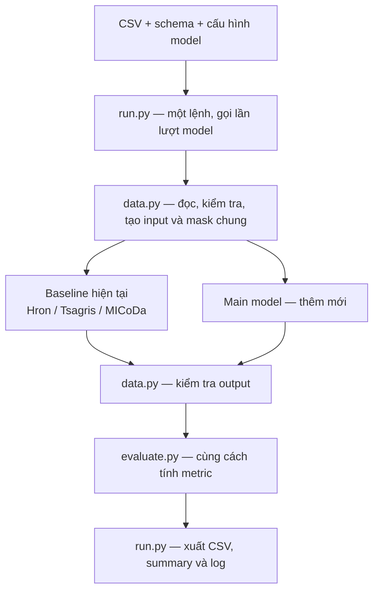
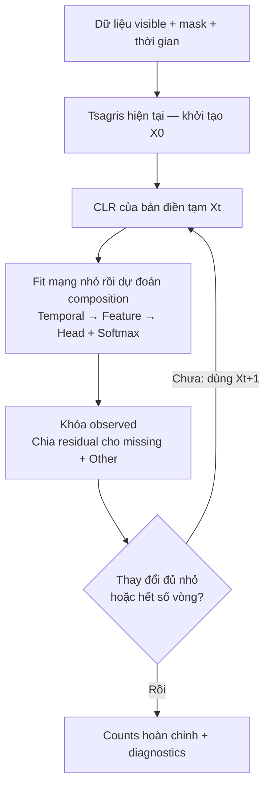

# Sườn main model — bản để duyệt

**Trạng thái: đề xuất, chưa triển khai. Chỉ bắt đầu sửa code sau khi người dùng duyệt.**

> Bản tóm tắt kiến trúc. Plan hiện thực hiện hành: [MAIN_MODEL_IMPLEMENTATION_PLAN_VI.md](MAIN_MODEL_IMPLEMENTATION_PLAN_VI.md). Dùng bản đó để chốt scope và thứ tự code; không coi các phác thảo cũ là những plan chạy song song.

## 1. Ý tưởng chính

**Một luồng chạy chung, thêm main model chứ không thêm pipeline mới.** Baseline giữ nguyên cách gọi; main dùng lại việc đọc dữ liệu, tạo mask, khôi phục counts, kiểm tra và đánh giá.

Hai nhánh là hai lựa chọn được runner gọi **lần lượt**, không phải yêu cầu chạy song song. Baseline và main nhận cùng evaluation mask; mỗi lượt có state riêng.

## 2. Bên trong main model

- **Khởi tạo một lần:** dùng Tsagris, không xây cơ chế chọn nhiều initializer.
- **Mạng một loại:** projection → một block nhỏ có temporal attention, feature attention, gate/residual → head softmax. Time/feature embedding và observed mask là thông tin đầu vào; chưa tối ưu số tầng.
- **Dự đoán composition trực tiếp:** CLR chỉ làm feature; không cần inverse CLR hoặc thêm reverse diffusion.
- **Sau mỗi vòng:** giữ observed, kể cả zero; dùng cùng quy tắc residual; kiểm tra hợp lệ và ghi mức thay đổi. Hết số vòng không đồng nghĩa đã hội tụ.

**Train không nhìn đáp án:** che thêm một phần observed để làm nhãn học; xóa các ô đó *trước* khởi tạo và CLR của bản train. Bản train tách khỏi bản điền thật nhưng dùng chung một mạng, không phải hai model. Evaluation mask không được dùng để train, chọn dừng hoặc tinh chỉnh.

## 3. Chia file tối thiểu

| File | Trách nhiệm |
|---|---|
| `src/longitudinal_impute/run.py` | Giữ CLI; thêm main và lựa chọn chạy từng phần. |
| `src/longitudinal_impute/data.py` | Giữ data/mask/budget/validator; bổ sung metadata thời gian. |
| `src/longitudinal_impute/evaluate.py` | Giữ định nghĩa metric hiện có. |
| `src/longitudinal_impute/baselines/` | Giữ interface và thuật toán mặc định. |
| `src/longitudinal_impute/main_model.py` **mới** | Chuẩn bị chuỗi, khởi tạo, train và loop cập nhật. |
| `src/longitudinal_impute/network.py` **mới** | Mạng và forward; không đọc file hay điều phối run. |

**Chỉ thêm hai file runtime.** Các bước trong sơ đồ là hàm trong file, không phải mỗi bước một module. Config và test bổ sung riêng; không tạo `engine`, `trainer`, `bridge` hay base class chung.

## 4. Cách chạy dự kiến

Vẫn dùng `python -m longitudinal_impute.run`. Những option sau **chưa được triển khai**:

| Nhu cầu | Cách chọn |
|---|---|
| Chạy full | Chọn file cấu hình chứa baseline + main. |
| Chỉ một hoặc vài model | File TOML chỉ khai báo các model cần chạy, tận dụng cơ chế hiện có. |
| Điền thật / đánh giá che giả / cả hai | `--pass native`, `masked` hoặc `both`. |
| Xem riêng khởi tạo | `--stage init`. |
| Chạy refinement từ kết quả đã lưu | `--stage refine --from-run ...`. |
| Chấm lại mà không train | `--stage evaluate --from-run ...`. |
| Đổi dataset | Đổi `--data` và `--schema`; giữ core và entry point. |

Một bước refinement gồm fit → predict → update, đúng với vòng lặp proposal. Bản đầu chỉ nối stage init→refine, không resume giữa minibatch/epoch/outer iteration. Baseline-only không cần PyTorch.

## 5. Triển khai theo bốn phần nhỏ sau khi duyệt

| Phần | Làm gì | Điều kiện chuyển tiếp |
|---|---|---|
| 1 | Metadata chuỗi + khởi tạo Tsagris | Đúng thứ tự dòng, observed bất biến, counts hợp lệ. |
| 2 | Mạng + train an toàn + một vòng cập nhật | Forward/backward chạy được, không leakage, không NaN/Inf. |
| 3 | Loop và tích hợp runner | Một lệnh chạy baseline + main; lỗi một model không chặn model khác. |
| 4 | Chạy từng phần + đổi dataset | Full khớp chạy tách trong tolerance; evaluate không fit lại; kiểm thử hai schema với số target khác nhau. |

Mỗi phần đều chạy lại test baseline. Hoàn thành sườn là **chạy đúng, dễ debug và không phá baseline**, chưa phải chứng minh main tốt hơn baseline.

## 6. Hai điều kiện dữ liệu cần chốt

1. **Total phải biết được:** dataset có NaN thật mà không có total hợp lệ chưa thuộc domain loader hiện tại. Không suy total từ đáp án bị che.
2. **Other đã chốt:** ba baseline mặc định D+Other/R2; main dùng cùng contract. Không thêm `has_other=false` vào MVP. Targets exhaustive cần quyết định domain riêng, không ngầm áp một mode khác.

Không thêm diffusion, nhiều transform/loss/initializer, hoặc cơ chế fallback ngầm trong bản đầu. Chi tiết hiện thực và kiểm thử tham chiếu [plan hiện hành](MAIN_MODEL_IMPLEMENTATION_PLAN_VI.md), trong đó network khởi đầu một block nhỏ, chưa phải số tầng đã tối ưu.

[Sơ đồ tương tác](../.archify/architecture-main-model-20261112-214858/main-model.html) là **minh họa thiết kế dự kiến**, không phải ảnh chụp kiến trúc đã triển khai hay bằng chứng source tại một commit. Nội dung sơ đồ bằng tiếng Việt; các nút viewer dùng tiếng Anh mặc định.
