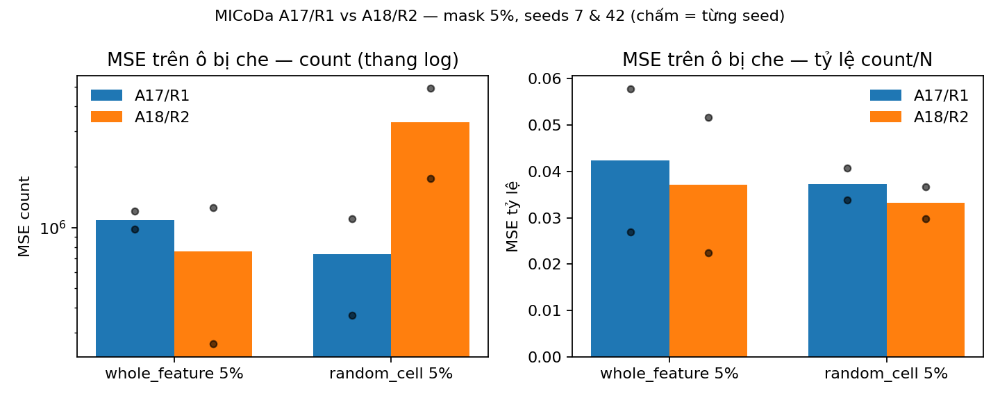
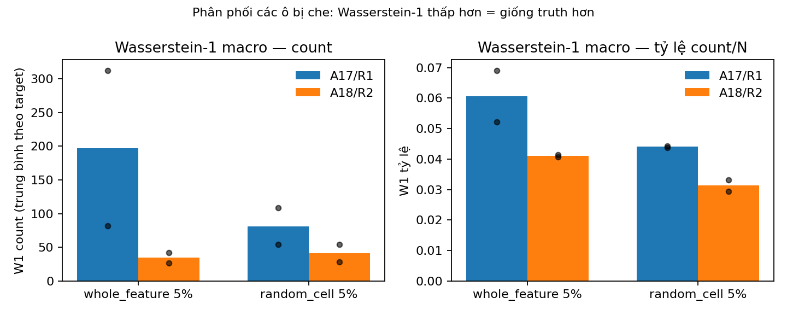
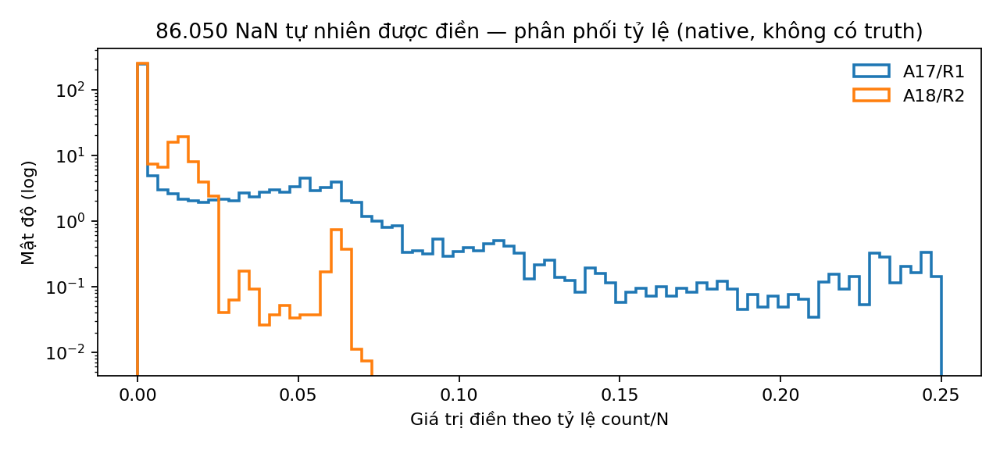
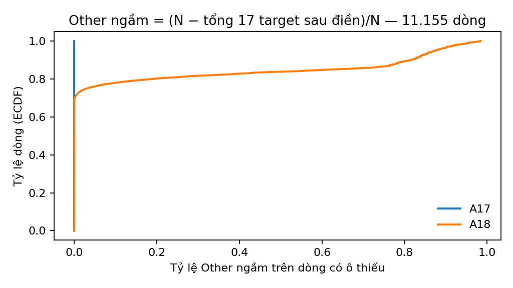

# Audit toàn bộ ba baseline — trạng thái ngày 30-10-2026

## 1. Kết luận ngắn

- **PR #3 đang giữ bản mới nhất**: head `2c8047e` có MICoDa **một file** (`baselines/micoda.py`) với **A17/R1 mặc định + option `other = true`** (A18/R2 sensitivity); Hron/Tsagris **trùng khít** head mới nhất của TV2 (`4b3e971`, diff 0 dòng) — gồm F1/F2/E1.
- **Pipeline vận hành ổn**: preflight trước mọi side effect, output không overwrite, lỗi/failed giữ nguyên mã gốc, partial có file riêng, exit code phản ánh lỗi, provenance (hash + git state) đầy đủ. **115 test pass** (RuntimeWarning là lỗi).
- **Không over-engineering**: không framework/plugin, đúng 3 model + 1 adapter, mỗi model một file, mọi file < 500 dòng. Có 4 điểm nợ nhỏ mức P3 — ghi nhận, không chặn review.
- **`evaluate.py` hiện thực**: W1 native theo target (count + tỷ lệ, 3 kiểu so), masked errors 6 nhóm × 4 metric × 2 scale, aggregate mean/sample-SD. **Chưa có trong repo**: W1 cho lượt masked, bootstrap/CI, correlation drift — các phần này là script phân tích cục bộ trong `.harness/` (đúng chủ trương: evidence nặng không vào src).
- **CROSSCHECK**: 7/9 mục đã xử lý xong; X1 là **quyết định khoa học** (đã ghi D04/D08 + gate), X9 (commit lớn) là lịch sử không rewrite.

## 2. Xác minh "mới nhất"

| Hạng mục | Giá trị kiểm tra | Kết quả |
|---|---|---|
| PR #3 head | `2c8047ec9fa53de5657ae59d8b5b898325ec99b1` | Mới nhất, khớp remote |
| PR #2 head (TV2) | `4b3e97177241b4e100853371372fb53d65944122` | Không đổi từ lần đối chiếu |
| Diff `hron.py`/`tsagris.py` vs TV2 head | 0 dòng | ✅ Đã có F1/F2/E1 |
| MICoDa | `baselines/micoda.py` 445 dòng, `other` mặc định `False` | ✅ Đúng D07/D08 |
| `micoda_covid.py` cũ | Không tồn tại | ✅ Đã gộp từ `abe460b` |
| `MICoDa18` trong `src/` | Không tồn tại | ✅ Lưu trữ tại `nextgen/docs/MICODA_A18_EVALUATION_VI.md` |
| Suite | **115 passed** (111 gốc + 4 test variant) | ✅ |
| Tái lập | A17 default + `other=true` đều **byte-identical** với run chuẩn | ✅ |

**Lưu ý:** `main` local của workspace đang dirty và **cũ hơn** — nguồn mới nhất cho baseline là nhánh `protocol-3-baselines` (PR #3). Không merge gì vào `main` trong phiên này.

## 3. Cấu trúc `nextgen/src/longitudinal_impute/`

| File | Dòng | Vai trò |
|---|---:|---|
| `run.py` | 232 | CLI, preflight, dispatch model, native + masked theo seed, summary/log, exit code |
| `data.py` | 236 | Loader nghiêm, mask, model_input/restore_counts (Hron–Tsagris), writer temp + hard link |
| `evaluate.py` | 76 | W1 native, forced-zero, masked errors theo nhóm, aggregate mean/sd |
| `baselines/micoda.py` | 445 | **Lõi V2** (dòng 1–214) + **adapter A17/R1 mặc định, A18/R2 qua `other=True`** (dòng 215–445) |
| `baselines/hron.py` | 100 | kNN Aitchison (2a), median adjust, ties=group |
| `baselines/tsagris.py` | 193 | JSD α-kNN + lifecycle an toàn (F1/F2) |
| `baselines/common.py` | 102 | Numeric contract dùng chung (matrix, simplex, softmax, distance order) |
| `baselines/regression.py` | 80 | OLS cho MICoDa |
| `baselines/diagnostics.py` | 31 | Canonical diagnostics |
| `errors.py` | 23 | Typed errors + context |
| `tests/` | — | 115 test (contract, lifecycle, hồi quy F1–F4/E1, variant A18) |

## 4. Review cấu trúc (thermo-nuclear)

| # | Mức | Phát hiện | Quyết định |
|---|---|---|---|
| S1 | P3 | `run.py` lặp ~25 dòng logic status/space/log/publish giữa vòng native và masked | Giữ nguyên: hành vi đã đóng băng (D08), tách hàm `run_one()` là refactor thuần nhưng rủi ro > lợi ích lúc này. Ghi nhận cho lần mở rộng tiếp theo |
| S2 | P3 | Nhánh R2 trong adapter lặp phép chia ngân sách của `data.restore_counts` (chỉ ở đường sensitivity, không phải mặc định) | Chấp nhận khi A18 là sensitivity; **bắt buộc hợp nhất** nếu A18 được thăng hạng |
| S3 | P3 | `MICODA_INFO_KEYS` là allowlist thủ công — thêm key diagnostics mới phải sửa hai chỗ | Chấp nhận: test phủ; typed dataclass là over-engineering với một adapter |
| S4 | P3 | `test_micoda_other.py` import `shutil` trong thân test | Cosmetic, không sửa để tránh churn |

**Những thứ đã kiểm và KHÔNG phải vấn đề:** không framework/registry trừu tượng thừa; không magic dispatch ngoài 1 nhánh `isinstance` có chủ đích (D07); không file nào > 500 dòng; không copy-paste model code; `data.py` giữ đúng vai trò biên dữ liệu, không rò policy model.

**Kết luận audit:** đạt ngưỡng approve — không có regression cấu trúc, không có nợ mức P1/P2; 4 điểm P3 là ghi chú, không chặn merge.

## 5. Đối chiếu CROSSCHECK_vi lần cuối

| Finding | Trạng thái hiện tại |
|---|---|
| X1 — R1 dồn Other vào target thiếu | **Quyết định, không phải bug**: ghi D04/D08 + gate; A18/R2 là đối chứng định lượng. Không dùng A17 làm benchmark xác nhận main model |
| X2 — failed mất lỗi gốc | ✅ Sửa: không gọi writer, giữ code/message/context, log + exit 1; có test thật (`insufficient_fit`) và 2 test giả lập partial/failed |
| X3 — thiếu F1/F2/E1 | ✅ Nhận nguyên từ TV2 head `4b3e971` (diff 0) |
| X4 — conflict data.py/test | ✅ Một loader width check (message chi tiết), writer hỗ trợ partial, một `validate_mask`, regex test dùng `field` |
| X5 — contract không nằm trong Git | ✅ `nextgen/docs/THREE_BASELINE_CONTRACT_VI.md` (D01–D08) |
| X6 — seed âm/trùng | ✅ Chặn trước side effect (test parametrized) |
| X7 — terminal thiếu `space` | ✅ Đã in cột space |
| X8 — code thừa | ✅ Bỏ import không dùng, width-check lặp, reassignment coverage |
| X9 — commit lớn `ade7d06` | Ghi nhận; không rewrite lịch sử đã chia sẻ |

## 6. `evaluate.py` hiện thực gì

| Thành phần | Có trong repo? | Chi tiết |
|---|---|---|
| W1 1-D chính xác | ✅ | `wasserstein(a, b)` — dùng cho native |
| W1 native theo target | ✅ | count + tỷ lệ; 3 kiểu: observed-vs-completed, observed-vs-imputed, observed-vs-model-imputed |
| Định nghĩa `forced_zero` | ✅ | ô thiếu có tổng visible = N → restore cho 0 bất kể model |
| Masked errors | ✅ | 6 nhóm (`all`, `truth_zero`, `truth_positive`, `forced_zero`, `model`, `model_truth_zero`) × `{cells, mse_count, mae_count, mse_proportion, mae_proportion}` |
| Aggregate | ✅ | mean + sample SD (ddof=1) qua các seed `ok`; `runs_ok/runs_failed` |
| W1 cho lượt masked | ❌ (cục bộ) | `.harness/micoda-statistical-evaluation/evaluate.py` — không đưa vào src |
| Bootstrap/CI ghép cặp | ❌ (cục bộ) | script trên: 150 địa điểm × 500 lượt |
| Correlation drift | ❌ (cục bộ) | script trên: |ΔPearson| theo cặp target |
| Coverage | ✅ (trong `run.py`) | `resolved_cells`, `coverage`; metric chỉ tính khi coverage = 1 |

## 7. Pipeline hiện tại (plain text)

```text
Người dùng: python -m longitudinal_impute.run --data --schema --models --output [--mask ... --seeds ...]

1. PREFLIGHT (chưa tạo gì trên đĩa)
   - output chưa tồn tại; load CSV nghiêm (đủ/đúng số field, số không âm, tổng ≤ N)
   - validate model TOML (khởi tạo thử; tham số sai → lỗi)
   - validate mask/rate/seed (mask none → bỏ qua kiểm tra mask)

2. TẠO OUTPUT + config.json (hash data/schema, models, mask, seeds, git commit + dirty flag)

3. NATIVE — điền NaN thật, không che gì
   - mỗi model instance mới:
     Hron/Tsagris: model_input (D+1, Other chỉ cho dòng đủ target) → fit/predict → restore_counts
     MICoDa A17:  counts/N/mask → A17 (δ=min/2, closure, headroom) → lõi ALR→refit → R1
     MICoDa A18 (opt-in other=true): như trên nhưng 18 phần, R2 chia residual với Other
   - completed → <model>_completed.csv + W1 native; partial → _partial.csv + lỗi;
     failed → KHÔNG CSV, giữ nguyên error code/message/context, log + exit 1

4. MASKED — mỗi seed một mask dùng chung cho mọi model
   - tạo & lưu mask_<kind>_seed<s>.npy; từng model instance mới
   - completed & coverage=1 → MSE/MAE theo nhóm trên ô bị che
   - partial/failed → không metric, giữ diagnostics, model khác chạy tiếp

5. TỔNG HỢP
   - summary.csv (1 dòng/model×lượt×seed, có space + resolved_cells) + summary.json (đầy đủ)
   - bảng terminal có space; errors.log khi có lỗi; exit 1 nếu có failed/partial
```

## 8. Kết quả định lượng

### 8.1 Masked 5% — trung bình 2 seed (7, 42), cùng mask byte-identical

| Mask | Metric | A17/R1 | A18/R2 |
|---|---|---:|---:|
| whole_feature | MSE count | 1.090.263 | **757.559** |
| whole_feature | MSE tỷ lệ | 0,04239 | **0,03705** |
| whole_feature | MAE count | 99,74 | **55,50** |
| whole_feature | W1 tỷ lệ macro | 0,06067 | **0,04103** |
| random_cell | MSE count | **734.706** | 3.341.057 |
| random_cell | MSE tỷ lệ | 0,03729 | **0,03325** |
| random_cell | MAE count | 74,04 | **71,97** |
| random_cell | W1 tỷ lệ macro | 0,04406 | **0,03129** |

MSE count từng seed: wf 7 = 976.689/262.920; wf 42 = 1.203.838/1.252.198; rc 7 = 1.104.106/4.932.527; rc 42 = 365.306/1.749.587. A18 random-cell bị ~10 ô chi phối ~99% tổng squared error — chưa chẩn đoán xong.

Bootstrap ghép cặp 150 địa điểm × 500 lượt (prediction cố định): Δ W1 tỷ lệ `A18−A17` CI 95% = [−0,0324; −0,0030], [−0,0213; −0,0070], [−0,0215; −0,0104], [−0,0169; −0,0080] (4/4 âm); Δ MSE count CI đều chứa 0 và rất rộng. Đây là bằng chứng **có điều kiện**, không phải p-value.





### 8.2 Native — điền 86.050 NaN thật (không có truth)

| Thống kê | A17/R1 | A18/R2 |
|---|---:|---:|
| Ô điền / observed / observed = 0 | 86.050 / 112.357 / 92.440 | như A17 |
| Mean count điền | 2,544 | 0,164 |
| Tỷ lệ điền bằng 0 | 70,42% | 70,42% |
| Tổng count điền | 218.946 | 14.091 |
| Other ngầm (mean/dòng có thiếu) | ~0% (100% dòng ≈ 0) | 15,08% (68,09% dòng ≈ 0) |
| W1 tỷ lệ observed-vs-imputed macro | 0,04492 | **0,03594** |
| W1 count macro | 75,14 | **74,70** |
| Target có W1 tỷ lệ thấp hơn | 3/17 | **13/17** |

A18 giữ Other, A17 dồn hết vào target thiếu — đúng cơ chế đã mô tả. Native chỉ là **mô tả phân phối**, không phải độ chính xác.





## 9. Kết quả nằm ở đâu

| Loại | Đường dẫn | Trong repo? |
|---|---|---|
| Báo cáo này + figure + script sinh figure | `docs/baseline_audit_2026-10-30/` | ✅ (PR #3) |
| Contract D01–D08, phản hồi cross-check, lưu trữ A18 | `nextgen/docs/*.md` | ✅ (PR #3) |
| Script tái kiểm chứng | `nextgen/scripts/verify_three_baselines.py` | ✅ (PR #3) |
| Bảng masked A17/A18 + CI đầy đủ | `.harness/micoda-statistical-evaluation/run-final/results.json` | ❌ cục bộ |
| Native audit + per-target W1 | `.harness/micoda-statistical-evaluation/native-audit-v2/` | ❌ cục bộ |
| Run gốc (summary + CSV + mask) | `.harness/baseline-crosscheck-update/{final-a17-run,final-a18-run,a17-reference-random,a18-fitpredict-random}` | ❌ cục bộ |
| Báo cáo thống kê/native/bàn giao chi tiết | `reports/*.md` | ❌ cục bộ (gitignore) |

## 10. Giới hạn

- Kết quả masked đến từ **2 seed × 2 kiểu mask** — đủ để so sánh có kiểm soát, chưa đủ khẳng định khoa học; chưa có tập xác nhận độc lập.
- Native không có ground truth: W1 native chỉ mô tả. Cả hai model điền dương vào ô truth-zero (80–85%) phần lớn thời gian — khuyết tật chung của chính sách zero, nằm ngoài phạm vi PR này.
- Bootstrap có điều kiện trên prediction đã fit; không refit, không điều chỉnh multiple comparisons.
- A18 là **sensitivity**, không phải mặc định; thăng hạng cần gate mới + hợp nhất allocation + chẩn đoán outlier.

## Tái lập

```powershell
# từ checkout của nhánh protocol-3-baselines
python -m pip install -e "./nextgen[test]"
python nextgen/scripts/verify_three_baselines.py --output <thu-muc-moi> `
  --data data/covariants.csv --schema nextgen/configs/baselines_covariants.toml

# sinh lại figure (cần evidence .harness cục bộ từ các lượt chạy đã ghi)
$env:PYTHONPATH='nextgen/src'
python docs/baseline_audit_2026-10-30/make_figures.py --harness <repo>/.harness
```
